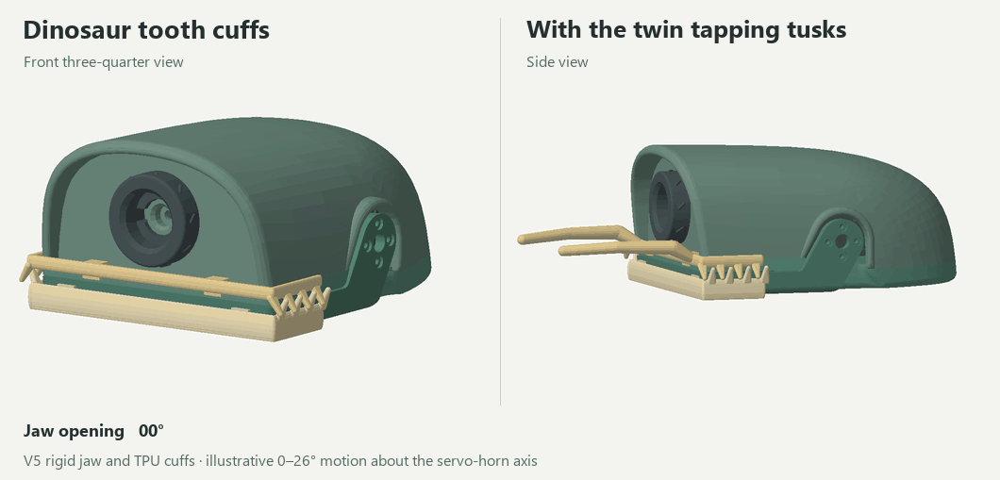
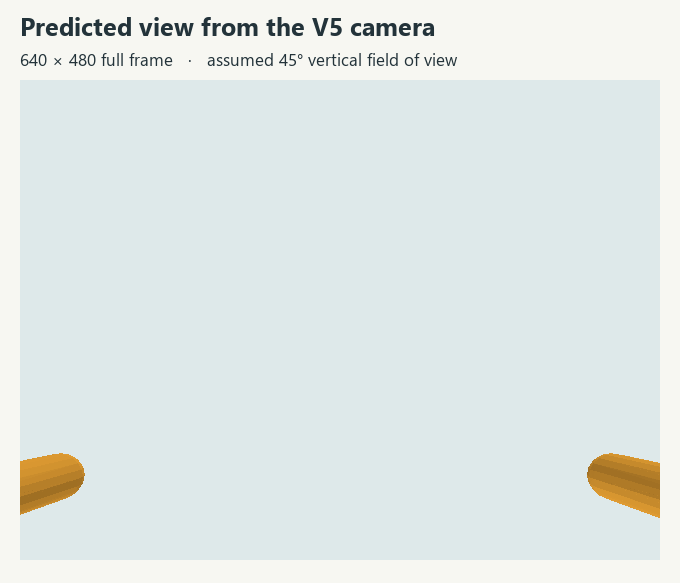

# V5 dinosaur beak and twin tapping tusks

Each jaw gets its own removable TPU cuff. Four rounded upper teeth alternate with four lower teeth along **each cheek**. The middle of the mouth stays open. Two optional tusks project forward from the outside corners of the upper cuff. A single soft tip can approach a key or a large button from the front. The design uses the existing rigid lips and leaves the factory TPU pads installed. Luwu attaches those pads with double-sided tape during assembly. [V5 stock meshes](https://github.com/LuwuDynamics/xgoduck_hardware/tree/4496fad52041db1cad36ded6cc49d942e037b4af/structure/V5_AUDIO_VIDEO_) · [Luwu assembly guide, step 21](https://wiki.xgorobot.com/kb/the-xgo-series-robot/duck-guide-06?model=duck)



## Choose the pieces

| Loadout | Upper print | Lower print |
| --- | --- | --- |
| Teeth | [Upper teeth](print/upper-teeth.stl) | [Lower teeth](print/lower-teeth.stl) |
| Twin tapping tusks | [Upper tusks](print/upper-tusks.stl) | Stock |
| Teeth and tusks | [Upper teeth and tusks](print/upper-teeth-tusks.stl) | [Lower teeth](print/lower-teeth.stl) |

The tip centres are 50.8 mm apart and 53.0 mm ahead of the rigid upper lip. Each rounded tip is 4.6 mm wide. A 5° head roll gives the two tips different heights. Test one tip at a time on an unpowered key switch or large loose button. Switch force, key travel, neighbouring key clearance and the actual Duck’s head pose determine whether it can type a key. We have no measured key-force or grip-force rating.

## Camera framing

The V5 head-camera site supplies the lens position. An ideal forward-facing 640 × 480 view at an assumed 45° vertical field of view shows both tusk tips in the lower corners. Together they occupy 2.04% of the frame and leave the central 60% clear. At 35° both tips disappear. Verify framing on the actual camera, including any preview crop, before using a tusk as a pointing reference. [Luwu camera guide](https://wiki.xgorobot.com/kb/the-xgo-series-robot/duck-ai-media)



## Print and fit

1. **Print the fit cuffs first.** They reproduce the full distance between cheeks and the flex of both side rails. Start with [upper 0.00](print/upper-fit-0.00.stl) and [lower 0.00](print/lower-fit-0.00.stl). Move to [upper 0.10](print/upper-fit-0.10.stl) or [lower 0.10](print/lower-fit-0.10.stl) if loose. There are also [upper 0.20](print/upper-fit-0.20.stl) and [lower 0.20](print/lower-fit-0.20.stl). Numbers give the **designed squeeze per cheek in mm**. The four finished meshes use 0.10 mm. Match each jaw to its own coupon result.
2. **Use a soft single-material print for the first fit.** Import at 100% in mm. The teeth-only files have a flat side against the print bed. Preview the cuff overhangs in the slicer. The tusk variants ship upright so the tips rise away from the plate. Use local support beneath suspended rails or roots where the preview shows a bridge. Remove support from all contact surfaces. A print with a hard tip would change the contact test. Snapmaker supports TPU of Shore 90A and above on the U1 and publishes TPU 90A and 95A HF profiles. Use the loading route for your filament and inspect the wipe tower if assigning another TPU colour. [U1 material support](https://www.snapmaker.com/en-US/snapmaker-u1/faq) · [Snapmaker TPU printing guide](https://wiki.snapmaker.com/en/snapmaker_u1/printing_guides/tips_for_reliable_tpu_printing)
3. **Disconnect power and support the head.** Offer the open ends from the bill tip, gently spread the cheek arms, and seat the crossbar against the front lip. The upper locator rests over the rigid upper bill. The lower locator sits under the rigid lower bill. Four rounded bumps on each cuff squeeze the *outside* cheek walls. Look along the bite line to confirm the stock TPU pads remain seated flat. For removal, spread the arms slightly and draw the crossbar forward.
4. **Check closure and retention by hand.** Use gentle travel through the existing mouth range. Watch the side rows for early contact, check the front locators and verify the arms stay on through gentle side and forward pulls. Stop at first resistance. The minimum nominal cuff clearance is 0.96 mm. Seating error on either jaw reduces that margin. Refit or adjust the model before applying servo torque. For the tusk variant, check camera and ToF output with the fully assembled optics and wiring.

## Geometry and clearance checks

The upper cuff uses the front section of the upstream `HEAD_BOTTOM` part. The lower cuff uses `JAW`. Each arm reaches roughly 25 mm along the outside of the bill. The two pairs of grip bumps reference ray intersections with the actual rigid cheek surfaces 8 mm and 20 mm behind the front. Each cuff locates against one jaw and comes away as a single part. The small spring deflection comes from the TPU arms. Print direction, friction, TPU hardness and the actual parts determine retention.

The screening pose registers the stock rigid parts against their counterparts in the walking model. The source JAW horn holes identify a lateral hinge axis through Y = 24.05 mm, Z = 20.30 mm in the jaw STL. The nominal placement of that jaw frame in the HEAD_BOTTOM frame is (+0.003, −24.894, −0.500) mm at zero angle. The V5 3MF locates the upper TPU pad, face shell and ToF housing. The lower pad sits in its matching floor recess. The CAD frames are in mm.

| Closest pair across 121 poses from 0° to 30° | Minimum gap |
| --- | ---: |
| Upper cuff with teeth and tusks to lower tooth cuff | 0.96 mm |
| Upper cuff to stock lower jaw / lower TPU pad | 1.88 / 4.75 mm |
| Lower cuff to stock upper jaw / upper TPU pad | 1.90 / 2.51 mm |
| Upper cuff to fixed face shell / ToF housing | 0.60 / 11.47 mm |

At the nominal seat each cuff intersects its own rigid jaw only where the four grip bumps are intended to compress. These are rigid mesh measurements at 0.25° intervals. Servo zero, deformation, cable routing, sensing field of view and contact loads still require a physical check.

| Part | CAD material volume |
| --- | ---: |
| Upper teeth | 1.354 cm³ |
| Lower teeth | 2.421 cm³ |
| Upper tusks | 3.625 cm³ |
| Upper teeth and tusks | 3.836 cm³ |

Weigh the printed pair for the Duck Lab mass profile. Actual mass depends on the filament, slice and support removal.

## Stock policy transfer and keyboard approach

Using the shipped walking and get-up ONNX policies, stock feet and the closed jaw, stock and all three head variants each passed seven nominal MuJoCo cases: forward walking, both turns and recovery from the front, back, left and right. Straight-line distances were 2.59 m stock, 2.58 m with teeth, 2.61 m with tusks and 2.61 m with both. The floor-contact screen used rigid boxes across each cuff with mass derived from its CAD volume at an assumed 1.20 g/cm³. It ran once per case and configuration. It does not exercise TPU compliance, the jaw servo, the charging backpack, skating or contact with a key.

With the closed head facing a flat panel squarely, both tips arrive together. At 5° lateral tilt, each tip in turn leads the remaining head geometry by about 4.43 mm in the rigid plane check. Over a horizontal keyboard with the head level, the lower jaw arrives first. Start contact trials with one upright test button, measure its force and travel, then test an adjacent passive key for unintended contact. A typing controller still needs targeting and press/release feedback.

The [transfer check](check-transfer.py) accepts the runtime checkout and an output JSON path. It requires the hardware generator dependencies plus SciPy, MuJoCo and ONNX Runtime.

## Rebuild and verify

Run from this directory with Python, NumPy, `manifold3d` and access to the pinned V5 STLs in the hardware checkout. In a sparse checkout the generator reads missing meshes from Git.

```sh
python dino-beak.py print --preload 0.10
python verify-fit.py
```

All exports use printer coordinates with the lowest point at Z = 0. Choose a separate output directory to keep an alternative squeeze setting. If the jaws need different settings, generate both sets and select the matching upper and lower files. For assembly-space meshes, use `build()` in the generator. The verifier checks each supplied binary STL for positive volume, one closed component and two incident triangles per undirected edge, then measures the two fitted cuffs throughout the nominal jaw sweep.

For a screw-free permanent tooth set, the [co-printed TPU jaws](coprint/README.md) include mechanically keyed teeth and a two-material fit coupon.
