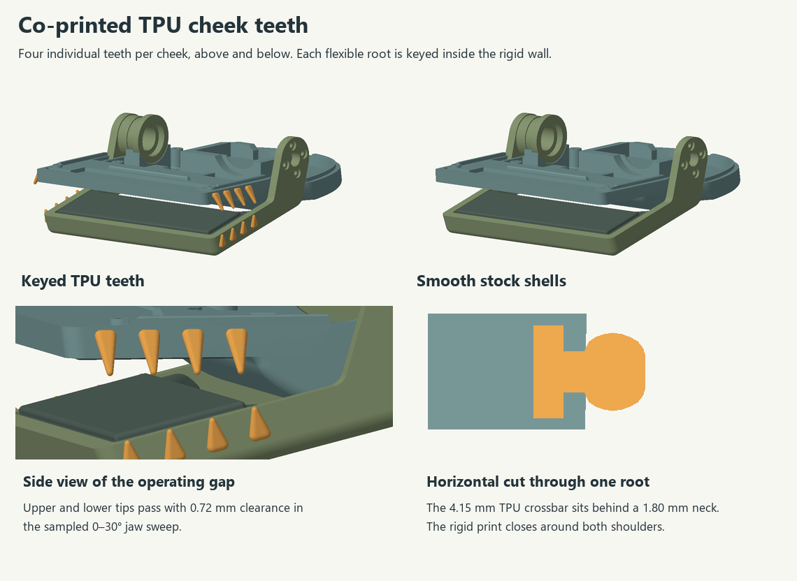

# V5 co-printed TPU teeth

Print a replacement upper head-bottom and lower jaw with four individually keyed TPU teeth on each cheek, sixteen in total. The stock gripping pads still fit inside the mouth. Each rounded tooth has its own buried crossbar and uses no screws, nuts, clips or external rail.

## What to print

| Part | File | Use |
|---|---|---|
| One-tooth coupon | [Actual cheek section on a grip foot](print/one-tooth-cheek-coupon.3mf) | Test the material pairing, tool registration, recovery from flex, and root retention first. |
| Upper shell | [HEAD_BOTTOM with eight keyed teeth](print/head_bottom-keyed-teeth.3mf) | Replaces the stock upper head-bottom. |
| Lower shell | [JAW with eight keyed teeth](print/jaw-keyed-teeth.3mf) | Replaces the stock moving jaw. |
| Optional lower shell | [JAW with eight teeth and the magnetic chin hatch](print/jaw-keyed-teeth-magnetic-hatch.3mf) | Print this lower shell in place of the plain toothed JAW. The hatch lid, steel targets and beard are separate parts in the [magnetic chin guide](../../v5-face-plates/magnetic/CHIN.md). |

To switch back to a genuinely smooth, hole-free front, install the original rigid upper and lower shells. Removing an embedded TPU tooth leaves its keyed recess in the printed wall. The screw-retained alternative uses removable cheek strips. [Stock HEAD_BOTTOM](https://github.com/LuwuDynamics/xgoduck_hardware/blob/4496fad52041db1cad36ded6cc49d942e037b4af/structure/V5_AUDIO_VIDEO_/V5_AUDIO_VIDEO_HEAD_BOTTOM.stl) · [Stock JAW](https://github.com/LuwuDynamics/xgoduck_hardware/blob/4496fad52041db1cad36ded6cc49d942e037b4af/structure/V5_AUDIO_VIDEO_/V5_AUDIO_VIDEO_JAW.stl) · [Screw-retained strips](../screw-teeth/README.md)

## Slicing for a multi-tool printer

1. Import the coupon 3MF as one multipart assembly. Keep the provided relative positions. It contains named **Rigid shell** and **TPU teeth** volumes with separate material IDs. Assign the rigid material and TPU to their respective tools in your slicer.
2. Check the layer preview at the sidewall. The TPU neck is 1.80 mm across. It widens into a 4.15 mm crossbar inside the rigid wall. The crossbar is 0.95 mm deep by 1.80 mm tall. Confirm the TPU tool prints both shoulders and the rigid tool closes around them. Inspect the tool offsets at the interface.
3. Print and flex the coupon with your intended filaments, layer height and cooling. Inspect the cheeks for splitting and test the tooth for pulling loose before committing to both shells. The geometrical key improves retention but its pull force depends on the printed layers and flexible material.
4. Load the selected shell files the same way. The whole assembly uses the upstream shell orientation. Check supports under the downward-pointing upper tips and any unsupported stock overhangs. Remove them carefully and confirm the upper and lower teeth clear through a slow unpowered jaw cycle.

## What the geometry checks establish

The generator pinned the official V5 meshes by SHA-256. It reconstructed the saved 3MF files and checked the material assignments, shared build transform, on-bed placement, closed triangle edges, component bounds and volumes. The rigid and TPU volumes partition each key without internal overlap. Each jaw contains eight separate closed TPU pieces surrounded by one rigid host. The original upper shell retains its internal cavity.

In a rigid pull simulation, shifting each tooth 0.65 mm straight out put at least **2.69 mm³** of TPU into rigid plastic. The same fore/aft shift in either direction produced at least **1.58 mm³** of interference. These results verify a geometric undercut. A flexible part can still deform, tear or pull out.

The stock-registered jaw swept **0° to 30° in 0.25° increments**. The closest opposing teeth came to **0.716 mm**. The closest tooth-to-pad gap was **0.724 mm**. The tooth geometry stayed at least **23.80 mm** from the optional lower hatch excavation. The upper teeth retain at least **23.99 mm** of lateral separation from the detachable chin parts throughout the sweep.

Estimated change for both shells together is **+0.40 g** at 1.20 g/cm³ for both materials, before any chin equipment. The estimates do not measure printed fit, wear, loaded deflection, grip force, or walking and get-up performance with this layout.

[Measurements](fit.json) · [Parametric geometry, exporter and checks](coprint.py) · [Figure source](render.py)

Run `python coprint.py` and `python render.py` in the hardware fork's CAD environment to regenerate these artifacts.
