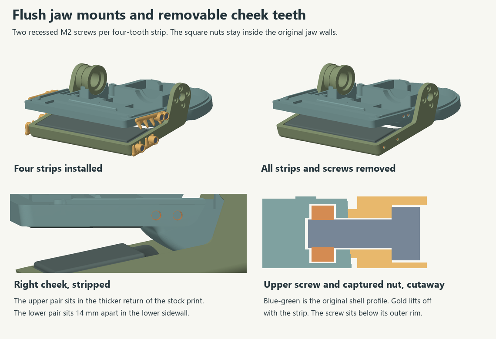

# V5 flush cheek mounts and removable side teeth

Remove both screws from a strip and lift it sideways. The curved seating pads, screw-head rims and all four teeth come away together. The two small lateral screw holes are the only visible change on each bare cheek. Four independent strips let you fit either side of either jaw. The stock TPU mouth pads keep their mounting points and gripping surfaces.

## Prints and hardware

| Desired rows | V5 part to replace | Replacement print | Removable strips |
|---|---|---|---|
| Upper | HEAD_BOTTOM | [Upper host](print/upper-jaw-flush-receivers.stl) | [Plus X](print/upper-plus-x-four-teeth.stl) · [Minus X](print/upper-minus-x-four-teeth.stl) |
| Lower | JAW | [Lower host](print/lower-jaw-flush-receivers.stl) | [Plus X](print/lower-plus-x-four-teeth.stl) · [Minus X](print/lower-minus-x-four-teeth.stl) |

The plus and minus labels follow the V5 STL axes. Each replacement subtracts four blind screw passages and four internal square-nut pockets directly from the pinned V5 mesh. Both empty hosts add **0 mm³** outside the originals, including on their inner faces. The upper host retains the original enclosed void.

Use four **M2 square nuts measuring 4.00 × 4.00 × 1.60 mm** per replacement host. Each mounted row uses two **M2 × 6 mm machine screws**, length under the head. The checked round head envelope is 3.80 mm in diameter and 2.00 mm high. Measure your actual nuts and screws before printing. Nuts stay inside the rigid host when the strips are removed.

The upper forward rim has only about 2 mm of wall at several tooth stations. Its pair of screws instead sits 4.90 mm apart in the thicker return behind the teeth, with a forward seating pad on the removable strip. The lower sidewalls have room for 14 mm screw spacing. The upper row needs a physical check for rocking under pressure at its forward tip.

## Printing and fitting

1. Print each rigid host in its exported orientation. Preserve the stock infill and wall settings around the screws, and keep slicer-generated supports out of the nut recesses. The nominal pocket is 1.94 mm along the screw axis and 4.22 × 4.23 mm across its square face.
2. In the sliced preview, identify the layer that first roofs the square pockets and pause **before** that layer. Pocket tops are **Z = 13.615 mm for HEAD_BOTTOM** and **Z = 7.115 mm for JAW**, measured from the bed. Choose the matching layer from the preview for your layer height. The upper lip has only 0.385 mm of nominal roof above its 4.23 mm cavity. Confirm a continuous closed roof in the sliced toolpaths. A combined beard/jaw variant can require more than one pause.
3. Insert all four nuts in the host on edge with their threads pointing out toward the cheek holes. Check every nut sits below the next nozzle path. Resume and allow the pockets to close.
4. Print each side strip in the supplied outer-face-down orientation. The two screw-head rims sit in one plane. Support the raised web as needed for your flexible filament and inspect the slicer preview around the small contact rings. Remove support, then dry-fit the curved feet against the bare cheek.
5. Start both screws by hand, then seat them evenly. In the CAD, each M2 × 6 screw traverses the full nut, ends 0.25 mm before the blind bore bottom and sits 0.50 mm below the strip rim. Try the fit unpowered, flex the forward tip gently and check jaw travel. Remove both screws to leave just two holes visible per side.

## Checks and limits

The generator confirmed each exported STL has closed edges and sits on Z = 0. It checked both nut recesses on both sides of both hosts plus a 0.25 mm envelope against the original solid. It also checked the blind end of each bore. The solids for the metal, strip and finished host have no shared volume.

The registered jaw moved through **121 poses from 0° to 30°**. The smallest moving gap to the opposite rigid jaw was **0.798 mm**. The closest upper and lower fittings came within **0.808 mm** of each other. Metal came within **0.506 mm** of the upper TPU mouth pad and **0.747 mm** of the lower pad. All fasteners stayed outside the modelled 55° vertical camera field. The complete numeric sweep and nominal camera assumptions are available in [fit.json](fit.json) and [screw-teeth.py](screw-teeth.py).

At 1.20 g/cm³ for the printed material and 7.85 g/cm³ for the steel envelopes, both hosts and eight captive nuts add about **0.91 g** to the stock pair when stripped. Fitting all four rows and eight screws brings this to **4.96 g** over stock. Weigh the assembled parts and test print strength, nut retention, jaw travel, walk and get-up. The earlier friction-fit teeth trials used a different contact profile.

Run `python screw-teeth.py` to rebuild the models and checks, then `python render-screw-teeth.py` for the figure. The scripts use the CAD dependencies and pinned official V5 inputs of the parent dino-beak assembly.
