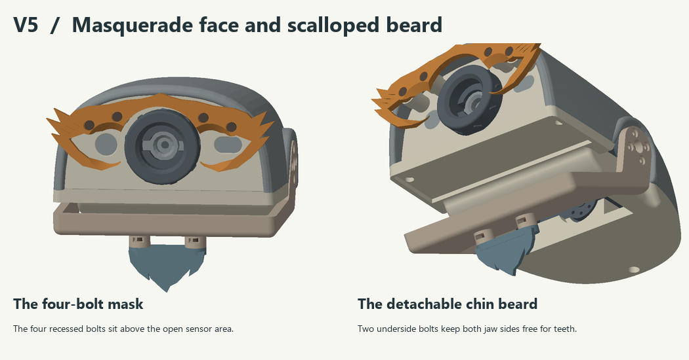
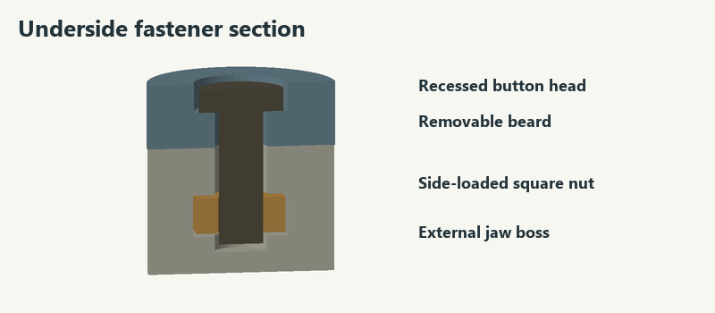

# Removable V5 masquerade mask and chin beard

The pierced brow has four front-facing bolts, two on each side of the central camera. The scalloped beard has two underside bolts on 22 mm centres. Both accessories come off independently after printing. The beard moves with the lower jaw. Its mounting points leave the separate left and right tooth rails available.

## What to print

| Purpose | Print |
|---|---|
| First check with your own filament and hardware | [Nut coupon](print/nut-coupon.stl) and [bolt coupon](print/bolt-coupon.stl) |
| Masquerade | [Replacement V5 FACE](print/face-four-nut-bosses.stl) and [mask](print/venetian-mask.stl) |
| Beard only | [Replacement V5 JAW](print/jaw-two-chin-nut-bosses.stl) and [beard](print/scalloped-beard.stl) |
| Beard and independent four-tooth cheek strips | Use the [combined replacement JAW](print/jaw-side-teeth-and-chin.stl) in place of the beard-only jaw. Add your choice of [side strips and upper host](../v5-dino-beak/screw-teeth/). |

The raised mounting bosses are additions to the original V5 meshes. Print the replacement hosts before assembling the head. The stock camera housing, mouth pads and servo hardware retain their existing mounting points. The lower side-strip nuts use a different pocket shape and installation method. On the **combined** jaw STL, the chin bosses lift the stock jaw surface 5.30 mm above the bed. The four side-nut pockets close at **Z = 10.81 mm** in the supplied orientation. Pause before the first layer that roofs them and check the layer in your slicer. The separate teeth-only jaw uses a different pause height. The two chin nuts slide in after printing.

## Six small recessed fasteners

Each attachment point takes one M2 × 6 mm machine screw (length under the head) and a square M2 nut. The modeled button head is 3.8 mm wide and 1.05 mm tall. The recess is 4.3 mm in diameter and 1.3 mm deep, leaving the head about 0.25 mm below the surface. Choose dark hardware for a more subtle finish. Check the head diameter and height of the actual screws.

The printed clearance hole is 2.4 mm. The 4.35 mm wide, 1.90 mm tall slot accepts a square nut measuring up to 4.0 × 4.0 × 1.6 mm in this design. Insert each nut from the side of its external boss, put the accessory against the flat ends and snug the screws by hand. The nut resists turning in the slot. With the screw removed, the nut can slide back out. The screw ends stop 0.90 mm above the original jaw skin and farther out on the face. The steel stays outside the mouth and electronics.

Print both coupons at the same settings as the parts. Check that your nut slides in, the bolt head sits below the rim and the stack clamps before the screw bottoms. The mask prints brow-side up with its flat underside on the bed. Check supports under the replacement jaw and face in your slicer, keeping breakaway material out of the nut slots. Slide in the face nuts before closing up the head if tool access is tight. Metal mass, print flex and servo load depend on the build.

## What the geometry checked

The generator uses the pinned upstream FACE and JAW prints plus the registered runtime head mesh. The brow clears the protruding camera housing and the shell lip. The sampled jaw sweep covers 0–30° in 0.25° increments, giving 9.19 mm minimum separation across the tested opposing parts. At neutral, the mask and its bosses clear the registered internal head hardware by 2.05 mm. Both forward 45° half-angle test cones remain clear. These are geometric sight lines. Actual camera framing, ToF readings and flex need a bench check.

Estimated material at 1.20 g/cm³ is 2.79 g for the mask and 1.46 g for the beard. The replacement hosts add another 2.81 g of plastic. Six M2 screw and square-nut pairs add an estimated 2.39 g at 7.85 g/cm³, for **9.45 g total**. Weigh the hardware and prints, dry-fit them, and open the unpowered jaw through its travel.

## Walking and getting up with both accessories

The stock walking policy took the fitted Duck **2.65 m in 20 s** on a flat simulated floor, compared with **2.59 m** for the stock Duck. Both stayed upright. The stock get-up policy also passed the four nominal 90° starts. Distance after standing is measured along the new heading.

| Start on | Stock get-up | Mask and beard get-up | Fitted walk after standing | Mask touching floor |
|---|---:|---:|---:|---:|
| Back | 2.76 s | 2.74 s | 2.28 m | 55 ms |
| Front | 2.92 s | 2.66 s | 2.31 m | 280 ms |
| Left | 2.56 s | 2.58 s | 2.30 m | 150 ms |
| Right | 2.86 s | 2.84 s | 2.28 m | 135 ms |

The simulator registered the CAD solids and hardware to the moving head. The stock walking model holds the mouth closed. Centre of mass and inertia came from the solid volumes. Small convex sections of the printed parts could touch the ground and trunk. The beard recorded zero ground contact in these runs. The mask contacted the floor in every recovery, so check the brow and its four fasteners before trying a physical get-up. These runs cover one start per direction and leave print strength, jaw-open recovery, and other surfaces untested.

To reproduce, run `python check-motion.py profile` in this directory with the CAD environment (NumPy, SciPy, manifold3d). Then run `python check-motion.py trials` in the runtime qualification environment (NumPy, MuJoCo, ONNX Runtime). The scripts expect the runtime repository beside this hardware repository, or accept `--runtime PATH`. The stock comparison uses the same policy files, floor, command and pass criteria.

[Motion results and policy hashes](motion-results.json) · [Registered collision and mass profile](motion-profile.json) · [Reproduction script](check-motion.py)

[Parametric source and clearance checks](face-plates.py) · [Measurements](fit.json) · [Render source](render.py)
