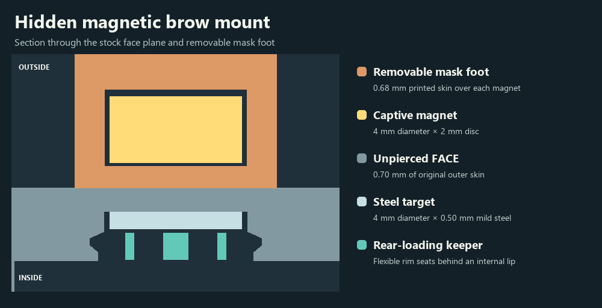

# Hidden brow targets for the V5 mask

Print the replacement [FACE](print/face-blind-steel-pockets.stl) now and leave it bare. The front retains the upstream surface, lens opening and bezel profile. Four blind pockets open only from the back. You can install the steel targets later by removing the FACE. All four protruding standoffs belong to the [removable mask](print/magnetic-mask.stl).

## What to print and fit

| Part | Quantity | Use |
|---|---:|---|
| [Blind-pocket FACE](print/face-blind-steel-pockets.stl) | 1 | Replacement for the stock V5 FACE. Print in the supplied upstream orientation. Leave pockets empty until wanted. |
| Mild steel target, Ø4.00 × 0.50 mm | 4 | Solid discs. Verify attraction to the selected magnet before installation. |
| [Flexible inside keeper](print/inside-target-keeper.stl) | 4 | Print in TPU. Each slotted rim snaps behind an internal shoulder and traps a steel disc. |
| [Magnetic mask](print/magnetic-mask.stl) | 1 | One rigid part containing four sealed magnet pockets. The supplied orientation puts the mask's decorated face towards the bed. |
| Disc magnet, Ø4.00 × 2.00 mm | 4 | Place each magnet into a mask foot during printing. Each pocket ends up enclosed in plastic on every side. Steel targets work with either pole facing the Duck. |

**Start with one [FACE coupon](print/inside-target-coupon.stl), one [magnetic foot coupon](print/magnetic-foot-coupon.stl) and one keeper.** Use the same materials, layer height, magnets and discs planned for the full parts. Test keeper insertion and pull-out, then normal separation, sideways slip and peel across the two printed skins. A nominal 1.49 mm separates the steel and magnet faces when seated. The attractive force and impact retention require measurement with the actual hardware. The four-post mask adds a separate alignment and peel test.

### Fit the targets later

1. Remove the FACE to access its rear. Set one steel disc flat against the blind end of each pocket.
2. Press a TPU keeper into each opening with its four tabs aligned to enter freely. The flat back of the keeper sits just inside the original rear plane. The front skin remains 0.70 mm thick. Check that every keeper is seated and each target is trapped before refitting the FACE.
3. To replace a target, remove the FACE again. Use the keeper's two small access holes from the rear to lift and flex the keeper out. Both magnets and steel targets remain isolated from the electronics in normal assembly.

### Capture the magnets in the mask

The mask STL contains **four intentional closed cavities**. Preserve them during slicing. Block support generation inside those cavities; external supports may be needed under the mask ornament in the supplied orientation. Each cavity is 4.28 mm across and 2.28 mm deep. The final mask-foot skin is 0.68 mm.

Use the slicer's layer preview to pause **before the first roof lines** across the magnet pockets. In the supplied mask orientation, the roof starts at model **Z 13.17 mm**; the foot coupon uses **Z 3.92 mm**. The actual layer and pause command depend on the chosen layer heights and slicer. The magnet must lie below the next nozzle path. Check cavity fill, retention against toolhead movement and the magnet supplier's temperature rating on the coupon first. Finish the roof after all magnets are seated. Keep loose magnets accounted for during assembly; a cracked foot that exposes a magnet needs replacement.

## Measured geometry

- Both inner target axes use the original brow points at X ±17, height 44 mm. The outer pair uses X ±30.1, height 39.6 mm, 2.28 mm from the previous screw axes. That shift preserves an upstream inner rib and clears the external shell lip.
- Each pocket has at least 1.00 mm of surrounding stock radially and admits a 2.55 mm-radius rear insertion envelope through the disassembled FACE. The two printed skins and inside keeper provide mechanical enclosure for the hardware.
- The mask clears the registered stock head hardware by 3.18 mm. The external shell skin, FACE_TOF carrier, HEAD_BOTTOM and upper mouth pad all cleared the solid-intersection tests. Synthetic forward cones with 45° half-angles from the camera and ToF sites intersected zero mask volume. Test actual images and distance readings with the installed sensors.
- A sampled jaw sweep from 0° to 30°, checked every 0.25°, maintained at least 15 mm clearance to the mask at the test's distance cap. Estimated mask plastic mass is 4.32 g at 1.20 g/cm³, before magnets. The mesh fit checks do not establish pull force or recovery reliability.

[CAD generator](brow.py) · [Dimensional checks](fit.json) · [Section generator](section.py)
