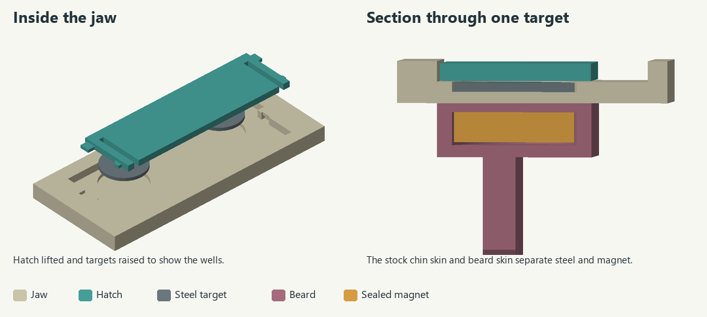

# Concealed magnetic beard

Print the replacement jaw now and fit the steel targets later. The outside chin has the original V5 surface, including the full, unbroken lower face. The hatch is on the mouth side, under the lower TPU pad. With the finished beard attached, the only exposed addition is the scalloped beard.

## Parts

| Item | Quantity and dimensions |
|---|---|
| [Replacement JAW](print/jaw-interior-steel-hatch.stl) | One. The internal hatch is suitable for a new print. |
| [Combined JAW for beard and screw-on side teeth](print/jaw-flush-cheek-pockets-and-chin-hatch.stl) | Alternate replacement jaw. The four M2 square nuts in the cheek walls are print-in inserts. Follow the [side-tooth print guide](../../v5-dino-beak/screw-teeth/README.md) and pause before those pockets close. The chin's steel targets can still be fitted after printing. |
| [Keeper](print/chin-hatch-lid.stl) | One. Two flexible side hooks share a single lid. PETG is a candidate for the flexures. |
| Ferromagnetic targets | Two plain low-carbon steel discs, Ø8 × 0.60 mm. Confirm a magnet attracts the alloy. |
| [Beard](print/scalloped-magnetic-beard.stl) | One with two closed cavities for Ø8 × 2 mm disc magnets. |
| [Hatch coupon](print/chin-hatch-coupon.stl) | One. Print this and the keeper before committing to the replacement jaw. |

## Fit the targets when needed

1. Fit the keeper to the coupon first. Check that both hooks catch, that lifting the rear edge does not open it, and that both tips release cleanly when squeezed. Check for sharp burrs on the steel.
2. On the unpowered Duck, open the mouth, remove the lower TPU pad and uncover the inside of the replacement jaw. A pad bonded in place will need its adhesive renewed. Drop one steel target in each circular well. The targets can be omitted while using the bare jaw.
3. Point the keeper’s two rigid ears toward the tip of the beak. Squeeze its rear spring tips inward and lower the ears into the wider entry slots. Slide **3.6 mm toward the beak tip** to the hard stop. Release both tips into the side notches. The lid sits 0.16 mm below the stock pad seat. Check that it resists lifting and backward sliding before refitting the pad.
4. To remove it, uncover the hatch, squeeze both tips inward with fine tweezers, slide 3.6 mm toward the hinge, then lift. The keeper captures the steel targets while seated, including with the pad removed.

## Print the removable beard

The STL stands on its flat chin mating face. At the exported 1:1 scale, the magnet cells start 0.60 mm above the bed and end at 2.80 mm. Using 0.20 mm layers, inspect the slicer preview and add a pause **before the first layer that bridges either cavity**. Insert one Ø8 × 2 mm magnet in each opening, seated fully below the nozzle path. Check your magnets' temperature rating against the actual bed, enclosure and insert process. Resume to print the 0.80 mm outer roof. Each magnet has 0.14 mm nominal radial clearance. The steel targets accept either pole orientation.

Check the slicer preserves both closed cavities and the straight bridges over them. On the coupon, inspect the retaining lips and the keeper’s small hooks for clean extrusion. A damaged or split beard exposes small magnets and should be taken out of use.

## What the prototype establishes

The upstream jaw is 2.80 mm thick in this area. The target wells leave 0.75 mm of continuous plastic on the outside. With the beard seated, each target and magnet are separated by **1.35 mm** of plastic. Through the modeled 0–30° opening sweep, the beard cleared the opposite rigid jaw and upper pad by at least 10.20 mm. The lower pad sits on the original deck and clears the installed keeper.

The seated keeper’s ears and snap hooks geometrically block a straight lift and backward translation. A sampled insertion and removal path with compressed hooks cleared the stock, including during target insertion. That test models the arm positions and leaves real spring force, latch durability and print tolerances for the coupon. The smooth chin provides little mechanical shear restraint. Check side-slip, rotation and pull-off with the finished material; a physical fall could detach the beard. The coupling has no measured holding-force rating.

| Modeled increment over the stock jaw | Mass |
|---|---:|
| Interior-cut jaw and lid, empty | −0.45 g |
| Jaw, lid and two steel targets | +0.02 g |
| Beard including two magnets | 3.00 g |
| Complete accessory | **+3.02 g** |

Estimates use 1.20 g/cm³ equivalent print density, 7.85 g/cm³ steel and 7.50 g/cm³ magnet density. Weigh the actual parts. Servo loading, sensor compatibility near magnets, and impact retention need checks on the assembled Duck.

[Parametric JAW-frame CAD and fit test](chin.py) · [Measured geometry and mass assumptions](chin-fit.json)

[Stock-policy walking, get-up and roll trials with the beard removed](OFF-TRIALS.md)
