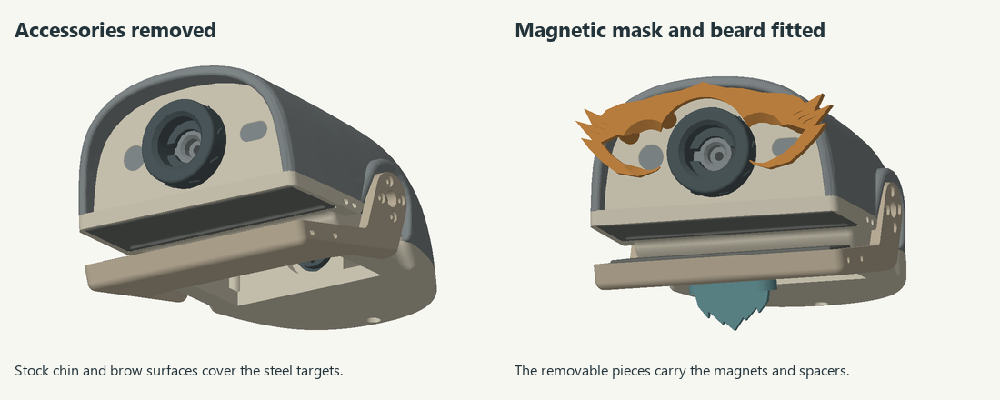

# Concealed mounts on the V5 face and jaw

The head and chin can be printed now and fitted with steel targets later. The mask and beard contain the magnets. The bare front face and underside of the beak retain their original outer skin. The optional tooth strips use separate flush holes in the sides.

| What you want to fit | Replacement to print | Access later |
|---|---|---|
| Magnetic mask | [Blind-pocket FACE](print/face-blind-steel-pockets.stl) | Open the head to insert the steel discs and printed keepers from behind. [Mask guide](BROW.md) |
| Magnetic beard | [Interior-hatch JAW](print/jaw-interior-steel-hatch.stl) | Lift the lower mouth pad and release the hatch to add or remove the steel targets. [Beard guide](CHIN.md) |
| Beard and optional screw-on tooth strips | [Combined JAW](print/jaw-flush-cheek-pockets-and-chin-hatch.stl) | Pause the host print for the four side nuts. The chin targets still install later. [Cheek fasteners](../../v5-dino-beak/screw-teeth/README.md) |

For upper tooth strips, print the matching replacement HEAD_BOTTOM from the cheek fastener guide. The stock face and jaw stay usable with the original hardware if you decide to print neither attachment.

Start with the matching magnet and keeper coupons in the guides. The removable mask and beard require a slicer pause to enclose their magnets. Check pull-off, sideways slip and retention after repeated fitting. Rigid geometric fits alone do not establish that a magnetic accessory will stay attached when the Duck gets up.

[Walk, four get-ups and forward-roll trials with the decorative mods removed](OFF-TRIALS.md)
