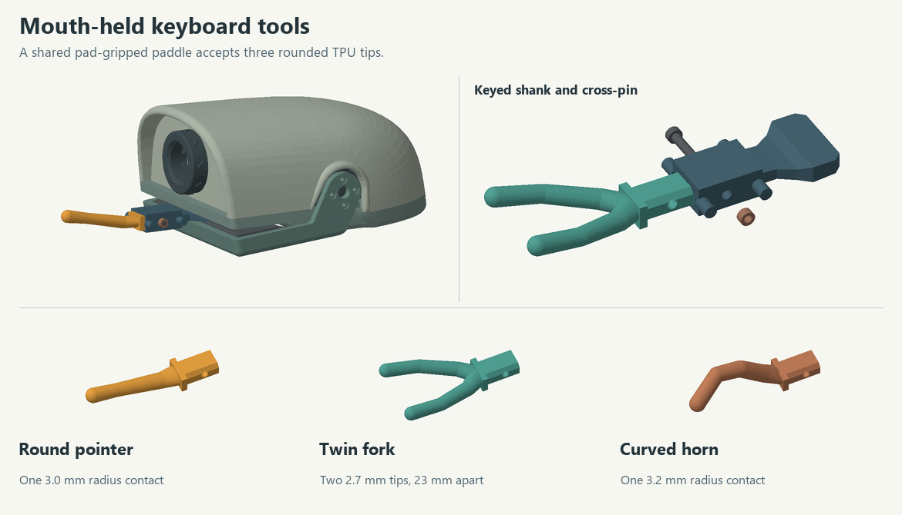
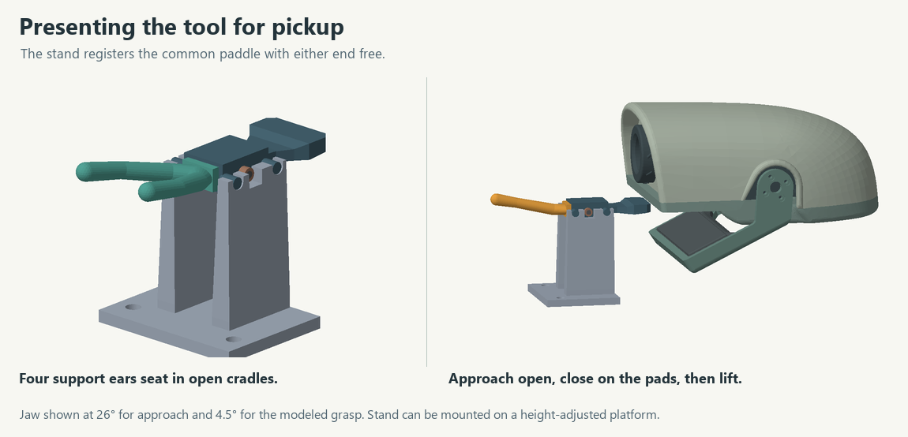
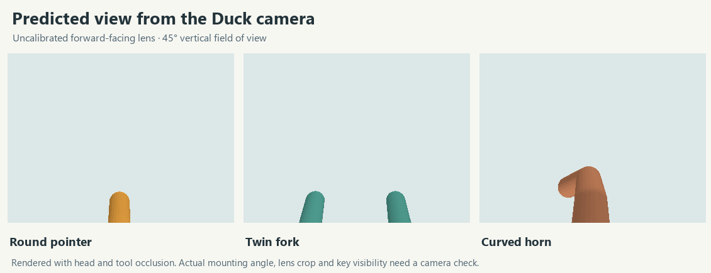

# V5 mouth-held keyboard tools

The Duck picks up a prepared handpiece by closing its existing TPU beak pads on a tapered paddle. The same rigid paddle has a keyed socket for a soft pointer, a forked pair of tips or a curved single horn. Change the tip at the bench with the transverse pin. The stand presents the complete tool to the Duck. These are unpowered CAD prototypes.



| Interchangeable TPU tip | Working geometry | Estimated complete handpiece |
| --- | --- | ---: |
| [Round pointer](print/pointer-tip-tpu.stl) | Single 3.0 mm radius contact | 6.12 g |
| [Fork](print/fork-tip-tpu.stl) | Two 2.7 mm radius contacts, 23 mm apart | 6.92 g |
| [Curved horn](print/horn-tip-tpu.stl) | Single 3.2 mm radius contact with a 7 mm sideways offset for visibility | 6.73 g |

Mass estimates use 1.24 g/cm³ for rigid parts and 1.20 g/cm³ for the flexible pieces, with the pin and collar installed. The fork can contact two keys at once. Use a one-tip version for initial single-key trials. The horn's offset introduces a twisting moment about the gripped paddle.

## Print and assemble

Print one rigid [paddle](print/jaw-paddle.stl), one rigid [headed pin](print/shoulder-pin.stl), one flexible [retaining collar](print/pin-collar-tpu.stl), a TPU tip and the [pickup stand](print/pickup-stand.stl). Units are millimetres. Slice the curved parts and the paddle's lateral support ears carefully, adding local support as needed. The model uses 0.25 mm clearance per face at the keyed tongue, a 2.50 mm pin and a 2.80 mm cross-hole. The TPU collar stretches over the end of the pin. Confirm both pin retention and smooth tip insertion on the first print.

Insert the keyed tongue until the tip shoulder meets the paddle housing. Line up the cross-hole, pass the pin through and push the collar on. Put the two pairs of horizontal ears into the stand's round-bottomed cradles. The fork, horn and pointer each place their estimated centre of mass between the two bearing lines. The stand has two 4.4 mm base holes for mounting to a stable surface.

## Pickup and release



In the supplied orientation the paddle grip is about 46 mm above the stand's mounting surface. Position the stand on a platform that puts the grip within the real Duck's measured reach. Measure that height in the intended stance.

1. Approach with the beak open. The CAD trial starts 30 mm back with the head 2.2 mm above the final grasp pose. The handle projects clear of the stand toward the Duck.
2. With the paddle between the TPU pads, lower the head 2.2 mm and gently close on the grip. In the registered model the grasp occurs around 4.5° from neutral. Use the real contact or current response to establish a limit. The first rigid-jaw interference appears between 3.5° and 4.0° in this model.
3. Lift vertically by 20 mm to clear the stand. The trial then retreats 32 mm. Return the tool on the reverse path, settle the ears fully, release the jaw and raise the head before backing out.

The geometric trial uses the official HEAD_BOTTOM, JAW and both original soft-pad STLs. At the modeled grasp the upper and lower pads overlap the handle by 19.23 and 43.79 mm³, respectively, indicating where the pads would compress. Both rigid jaws remain clear over 44 sampled angles from 26° open to 4.5°. The stand stays clear through the prescribed approach, lift and exit. Grip force, slip, drop resistance, key actuation force, autonomous pickup and hardware reach are unmeasured. First try an unpowered pad fit, then a supported force-limited grasp on a test surface. [Fit and flat-contact measurements](fit-results.json) · [Check source](verify-tools.py)

## Camera and contact aim



The image uses the registered head-camera landmark and assumes a straight-ahead lens with a 45° vertical field of view. The render tests occlusion by the head and handpiece. At 360 × 270 pixels it shows 319 pixels on the pointer's working end, 40 and 38 on the fork ends, and 30 on the offset horn. The rest of the coloured shape can be visible even when a tip is hidden. The 35° and 55° trials also showed at least part of every tip. Verify the real lens direction, crop, and nearby key visibility with both the actual camera and tool installed. [Projection results](camera-results.json)

With the head pitched downward 20°, the modeled working end of each option reaches a flat plane before the rest of the registered nose and tool. At 10° another surface reaches first. This test treats the surface as continuous. Keyboard rows, key spacing and key travel require a keyboard-specific test. Before enabling contact, calibrate a single target and check the contact location, available jaw grip and pressure against a dummy key.

## Reproduce the drawings and checks

Use NumPy, SciPy, manifold3d, Pillow and Numba. Run from the hardware checkout with its matching Duck Lab runtime checkout alongside it.

```sh
python accessories/v5-mouth-tools/mouth-tools.py
python accessories/v5-mouth-tools/verify-tools.py
python accessories/v5-mouth-tools/render-tools.py ../xgoduck_runtime_arduino
```
