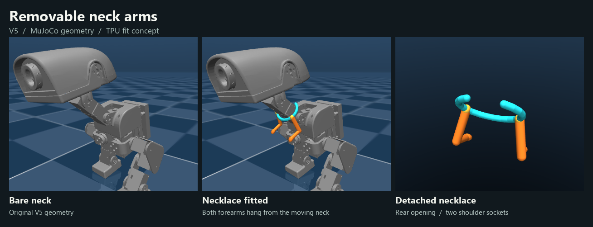

# Removable neck arms and the curved tail

The 167 mm tail with bilateral roll shoes and two passive TPU arms walked 3.077 m in 20 s. In the separate right-side fall trial it recovered in 3.28 s and walked another 2.546 m. Increasing tail length to 200 mm reduced those distances to 2.569 m and 2.023 m. The bare Duck walked 4.673 m. All three new tail lengths recovered on the tested side, and all three still fell below the 3.504 m walking gate.



## Wearing and removing the parts

The proposed necklace clips around the **lower moving neck**, below the head. It has a rear opening and two front-side sockets. An operator could detach either arm from its socket, then remove the necklace independently of the slide-on tail. A solid TPU clip and two bent arms would use no electronics. The model assigns the necklace to MuJoCo body `neck`, so its weight follows the actual neck joint.

| Part | Modeled size and estimated mass |
|---|---|
| Split collar and two sockets | 32 × 40 mm elliptical centreline, 4.4 mm round section, 64° rear opening. 2.063 g including both sockets. |
| Each arm | Shoulder to elbow extends 11 mm forwards, 5 mm outwards and 21 mm down. The paw sits 28 mm forwards, 4 mm out and 14 mm down from the shoulder. 1.799 g per side. |
| Collar and both arms | 5.661 g. The sockets attach 18 mm either side of centre. The model retains all 14 stock actuators and adds two passive hinges. |

The shoulder model allows ±22° of fore–aft swing with 0.003 N·m/rad stiffness. Capsule densities assume TPU at 1.20 g/cm³. The two upper and forearm capsule ends overlap at the elbow, so printed mass will differ slightly. The collar plane crosses the stock neutral neck mesh at approximately 20 × 27 mm. The ellipse is a packaging estimate. Retention force, servo travel, cable clearance, USB access during removal and repeated flexure need a physical fit check. The rear board carries no collar fastener. The socket geometry and the snap retention still need CAD before printing.

## Paired runs

Each cell uses the same unmodified walking and get-up ONNX weights. Walking was commanded at 0.45 m/s with a 12° pitch reference and neck/head inputs of −48°/−65°. Recovery started at 90° on the Duck's right side. Every run used the same deterministic starting pose and 20 s of level-ground simulation. The neck loadout order in each cell is **no collar / empty collar / collar with both arms**.

| Curved tail | Rear package mass | Walk distance in 20 s | Right recovery time | Distance after right recovery |
|---|---:|---|---|---|
| No tail or mount | 0 g | 4.673 / 4.934 / 4.819 m | 2.86 s / failed / failed | 4.054 m / — / — |
| 167 mm | 83.707 g | 2.972 / 3.004 / 3.077 m | 3.28 / 3.26 / 3.28 s | 2.457 / 2.488 / 2.546 m |
| 185 mm | 89.877 g | 2.715 / 2.748 / 2.798 m | 3.30 / 3.32 / 3.34 s | 2.197 / 2.239 / 2.289 m |
| 200 mm | 95.019 g | 2.490 / 2.538 / 2.569 m | 3.38 / 3.36 / 3.38 s | 1.940 / 1.979 / 2.023 m |

These rear packages use the narrower 90%-width shell, compact bilateral roll shoes with their lower anchor at −66.5 mm, and a passive tail joint. Their get-up controller resumes neutral walking, then ramps to the moderate forward lean. Both collar-only and collar-with-arms combinations **without a tail** repeatedly fell during this handoff and finished down. Removing the collar as well restores the tested stock configuration. With a gentler 0.20 m/s neutral walkoff, all three no-tail combinations recovered in 2.86 s.

The earlier full-width package used the rail and cover without the extra roll shoes. On that mount, none of the nine tail-equipped combinations got back up from the right side, even with the neutral 0.20 m/s walkoff. Their 20 s walk distances were 2.917 / 2.964 / 2.978 m at 167 mm, 2.632 / 2.670 / 2.743 m at 185 mm, and 2.396 / 2.445 / 2.505 m at 200 mm. Two changes separate the rear packages, so the comparison alone cannot attribute all improvement to the shoe shape.

## How much do the arms counterbalance?

The following walking means cover seconds 5–20. Gravitational pitch moments are calculated about the midpoint between the two foot sites, along the Duck's instantaneous heading. Positive values pitch the nose down. The rear package includes the tail, mount and shoes.

| Tail with collar and arms | Collar | Arms | Rear package | Mean trunk pitch | System centre of mass ahead of foot midpoint |
|---|---:|---:|---:|---:|---:|
| No tail | +1.39 mN·m | +2.39 mN·m | 0 | 13.63° | 30.06 mm |
| 167 mm | +1.30 mN·m | +2.42 mN·m | −80.15 mN·m | 8.53° | 11.86 mm |
| 185 mm | +1.31 mN·m | +2.45 mN·m | −89.63 mN·m | 8.37° | 11.12 mm |
| 200 mm | +1.32 mN·m | +2.48 mN·m | −97.87 mN·m | 8.20° | 10.53 mm |

The necklace and arms offset about 4.6% of the 167 mm rear package's gravitational moment in this posture. The longer tail costs much more moment than the arms restore. The 167 mm configuration produced measured arm angles from −0.77° to +1.21° across both sides at 10 Hz. The tested shoulder therefore gives only a subtle wobble. No sampled steady-walk frame had collar or arm contact with the floor. Those snapshots can miss short contacts between frames.

For a first mechanical prototype, the 167 mm roll-shoe combination gives the strongest walking result in this family. Verify whether the shorter tail can meet the stock-relative gait gate and repeat recovery from left, front, back and intermediate angles before treating the configuration as reliable. An arms-on stock Duck also needs its own recovery-to-lean transition test. Physical measurements of TPU hinge stiffness, mass, neck contact, lateral clearance and print retention would replace the current assumptions.

## Reproduce

The runtime checkout supplies MuJoCo, ONNX Runtime, models and the original gait/recovery gates. Run these commands in its configured Python environment. The result files include policy and experiment input hashes.

```text
python arms-study.py PATH_TO_RUNTIME arms-study.json
python arms-study.py PATH_TO_RUNTIME arms-roll-shoes.json --roll-shoes
python arms-render.py PATH_TO_RUNTIME figures/necklace-arms.png
```

The gait gate requires an upright finish, zero detected falls, at least ten footfalls on each side, and ≥75% of the stock distance with a 1.5 m floor. The fall gate requires a single fall/get-up/walk sequence, upright finish, recovery within 8 s, at least 0.75 m of subsequent travel, and five footfalls on each side. Each case here is a single matched trajectory. All outcomes are from simulation.

[Original mount measurements](arms-study.json) · [Bilateral roll-shoe measurements](arms-roll-shoes.json) · [Experiment source](arms-study.py)
