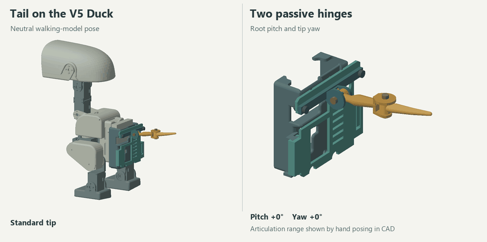
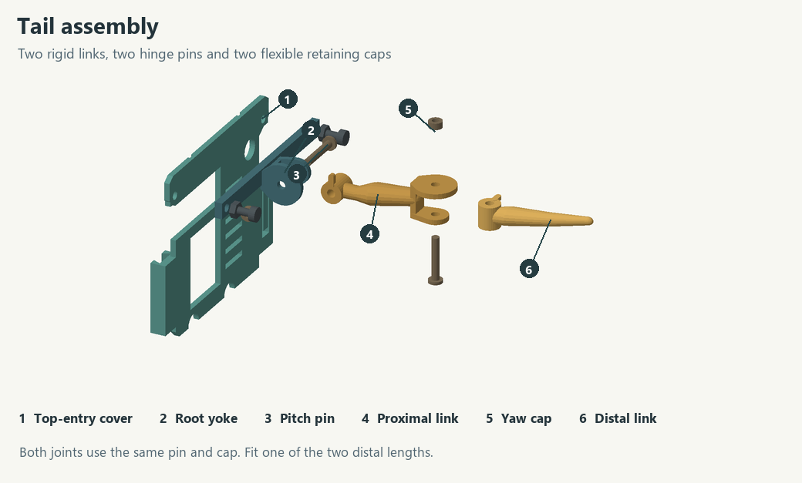

# Passive velociraptor tail for the V5 Duck

This removable backpack fits the **V5 audio/video enclosure with the V1.1 top-entry rails**. Its root pitches up and down, and its distal link yaws left and right. Both hinges move freely within printed stops. With the Duck upright, load and friction determine where the links settle. The CAD animation poses the joints by hand. An active tail would need actuators and a separate design.



## What to print and fit

The passive tail completed the stock walking trial but failed right-side get-up. See the [motion trials and forward-running training setup](MOTION-AND-TRAINING.md) before printing. The [reader and tag fit guide](../v5-slide-on-backpack/PACK-ID.md) covers the optional NFC hardware for both backpack types.

The standard and short tips share the same root. The standard outer tip reaches 96 mm behind the stock rear plane with the tail straight. The short option reduces this to 81 mm. The fork at the root sits 14 mm aft of that plane.

| Item | Quantity | Notes |
| --- | ---: | --- |
| [V1.1 top-entry rail enclosure](../v5-slide-on-backpack/README.md) | 1 per Duck | The same fixed rail enclosure accepts the charging backpack. An existing top-entry installation accepts this cover directly. |
| [Tail cover](print/tail-cover.stl) | 1 | Rigid filament. The shared charging rails fit the printed female grooves. This alternate cover has an inward-facing tag recess and mounting ears for the yoke. |
| [Root yoke](print/root-yoke.stl) | 1 | Rigid. The flat clamping face mates to the rear of the cover. |
| [Proximal link](print/proximal-link.stl) | 1 | Rigid. Its smaller round knuckle goes into the yoke. |
| [Standard distal link](print/distal-link.stl) or [short distal link](print/distal-short.stl) | 1 | Choose one length. The rounded end points aft. |
| [Headed pin](print/root-pin.stl) | 2 | Rigid. Each nominal shaft is 2.92 mm in diameter and each bore is 3.28 mm. |
| [Push-on retaining cap](print/root-cap.stl) | 2 | Flexible TPU. Its 2.68 mm unstretched bore grips the pin. Check withdrawal force in the actual material. |
| M3 × 8 mm screws and matching M3 nuts | 2 pairs | The fixed yoke bolts to the cover once. Routine backpack changes use the rail latch. |
| Adhesive NFC tag | Optional | The inward pocket takes a 6 × 17 mm tag, up to 0.7 mm total thickness including adhesive. |

The supplied STLs are in millimetres, at 0.25 mm normal clearance per rail face. Print a pair of pins and caps and check one joint before printing both links. Fit varies with material and slicer settings. Inspect the overhanging fork ears and tapered links in the slicer and enable local support where needed. Keep material out of the bearing bores, stop surfaces and release tongue. Platform adhesion, support-free printing and pin retention still need a physical print.



1. Insert each M3 screw through the yoke from the rear and through the cover's outboard ears. Fit the nuts on the inward face. Check that neither nut reaches the shared rail enclosure during the full slide.
2. Place the proximal link knuckle in the root fork. Align its short radial tongue between the two stop pegs inside the larger ear. Insert the headed pin from the small ear and push the TPU cap onto its exposed end. Leave the fork ears free of axial squeeze.
3. Attach the chosen distal tip the same way. The second pin runs up and down with the tail straight. Confirm that both hinges swing freely and that each stop pair catches its tongue.
4. If using a tag, place it completely inside the recess on the board-facing surface. Hold the Duck upright and lower the cover from above until both shoulders seat and the rail latch engages. To remove it, release the latch and lift the assembly toward the head. The tail and charging harness occupy the same mounting rails.

## Geometry, mass and fit checks

| Model addition vs stock | Standard | Short |
| --- | ---: | ---: |
| Fixed print additions, yoke, root pin/cap and two screw/nut pairs | 20.27 g | 20.27 g |
| Proximal link and distal pin/cap | 3.36 g | 3.36 g |
| Distal link | 1.74 g | 1.27 g |
| **Total nominal mass** | **25.37 g** | **24.90 g** |
| Estimated range | 18.44–27.72 g | 18.10–27.22 g |

The mass estimate uses nominal densities of 1.24 g/cm³ for the rigid parts, 1.20 g/cm³ for the flexible caps and 1.02 g for each screw/nut pair. The fixed subtotal includes the net added rail material once. A Duck already fitted with the shared rails carries that material before installing either pack. The optional tag and fixed reader electronics are additional. Weigh the final assembly before using its mass for a policy. [Part masses, centres and axes](tail-layout.json)

In CAD the first contact occurs at approximately **±18.19°** on both hinges. Duck Lab uses a **±16° working range**. The check sampled 73 individual positions per hinge and 25 combined positions for each tip. The released cover cleared the stock rail enclosure through 76 mm at all three fit choices. It also cleared the optional fixed reader, antenna and carrier with the 0.7 mm tag installed. The two snug TPU cap bores intentionally interfere with their pin shanks. Cap retention, wear, real joint friction, fall loading and recovery are unmeasured. [Geometric checks](fit-results.json) · [Fit checker](check-fit.py)

The stock-frame origin is the upstream enclosure STL origin. Positive Y points toward the head and negative Z points aft. The pitch axis is +X through (0, 25, −14) mm. The yaw axis is local +Y through (0, 29, −54) mm in the neutral position. The standard assembly's estimated incremental mass centre is (−0.51, 8.26, −10.57) mm.

Duck Lab runs the same stock policies on the bare Duck, an installed tail with locked joints and the same tail with passive joints. Inspect the per-case walking, turning and directional get-up outcomes before choosing a training variant. [Stock-policy simulation results](stock-policy-screen.json) · [CAD-derived physics profile](tail-physics.json)

## Reproduce the files

Install NumPy and manifold3d for CAD generation and geometric checks. The render additionally uses the Duck Lab walking model, MuJoCo, SciPy, Numba and Pillow. Run these commands from the hardware fork.

```sh
python accessories/v5-raptor-tail/raptor-tail.py accessories/v5-raptor-tail/print --runtime ../xgoduck_runtime_arduino
python accessories/v5-raptor-tail/check-fit.py
python accessories/v5-raptor-tail/render-tail.py ../xgoduck_runtime_arduino
```
