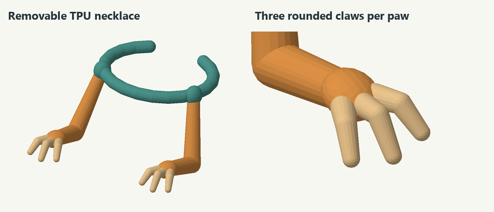

# Three-claw T. rex necklace

The two wobbly arms and their open-backed collar print as one flexible TPU part. There are three distinct rounded claws per hand. The middle finger extends slightly farther and each tip has a 1.12 mm radius. The rear opening slips around the lower moving neck. Removing the collar takes all six fingers and both arms with it. The stock neck needs no modification.

[One-piece STL](three-claw-necklace.stl) · [Rotating CAD preview](three-claw-turntable.webp) · [Bare neck and fitted necklace](bare-and-worn.png)

Print at 100% in millimetres. Inspect local supports for the forearms, collar and curled fingers in the slicer. Colours in the preview identify the parts of the geometry. At 1.20 g/cm³ the solid print estimate is 4.69 g, of which the digits add 0.37 g. The STL was reloaded and checked for a closed mesh, and all three fingers on each hand are separate beyond the palm. The print has a thinner flexible shoulder than the ideal passive hinge used in the simulation. Measure the opening, neck cable clearance and spring-back on the actual print.

At 0.45 m/s command with a 167 mm curved tail and the paired simulated runners, the smooth and three-claw arms traveled 3.077 and 3.064 m in 20 s. Both stood up in 3.28 s from their right side and traveled about 2.55 m after recovery. This is one matched flat-floor trial per design, with a passive hinge and capsule approximation for the TPU. The physical collar and all fall directions still need testing.

[Geometry and mass](print-fit.json) · [Comparative trials](policy-trials.json)
