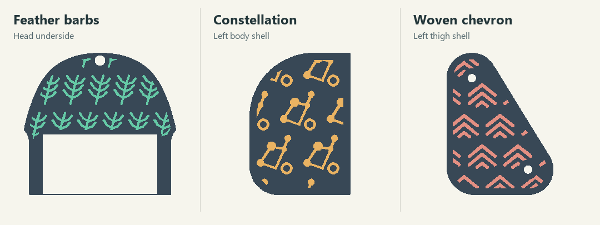

# Two-colour V5 shell art

Feather barbs, constellations and woven chevrons fit the V5 audio/video head underside, left and right body shells, and both outer thigh shells. Each printable 3MF contains one positioned assembly. Assign **Shell** and **Artwork** to two colours of the same filament on the U1. In Snapmaker Orca, keep the supplied parts together, enable the U1 printer profile and inspect the first layers in the sliced preview. [Snapmaker Orca quick start](https://wiki.snapmaker.com/en/snapmaker_orca/qsg.md)



The default flush inlay replaces the outer 0.4 mm of stock plastic in each marked region. The two solids fill the original envelope. Equal-density solid parts therefore keep both mass and its distribution. For different filament densities, multiply **accent volume in cm³ × density difference in g/cm³** to estimate the mass change in grams. The actual sliced object can also change slightly as the slicer adds internal perimeters, adjusts infill or uses different flow settings. Compare the two **object** estimates using identical slicing settings, then weigh the replacement shell. The prime tower and purge material stay off the Duck.

## Generate a set

Run from the hardware repo with Python, NumPy and manifold3d. The generator reads the upstream STLs, checks their hashes and writes each part separately. It can also read missing files from the pinned Git revision.

```sh
python accessories/v5-shell-art/shell-art.py output --style feather
python accessories/v5-shell-art/shell-art.py output --style orbit
python accessories/v5-shell-art/shell-art.py output --style chevron
```

Use `--finish relief --depth 0.2` for a shallow raised accent with a matching inner recess. The mask is restricted to broad parallel wall faces, inset at least 2 mm from changes in the inner profile. The outer accent moves some material outward. Added and removed volumes balance, while their positions change slightly. Check the selected surface against the assembled joint, dock, backpack or jaw, and verify print orientation and bed contact in the slicer. Where a face serves as a bearing or impact surface, use flush artwork. `--finish engraved` removes the marked volume. It produces a single-material shell.

Duck Lab shows representative markings on the walking model. The printable masks use the separate, checksum-verified V5 STL surfaces and exclude holes and curved edges. A flush same-material colour change can share the stock mass model. A change in material, print density, contact geometry or measured fit needs another check. [Upstream V5 print set](https://github.com/LuwuDynamics/xgoduck_hardware/tree/4496fad52041db1cad36ded6cc49d942e037b4af/structure/V5_AUDIO_VIDEO_)
