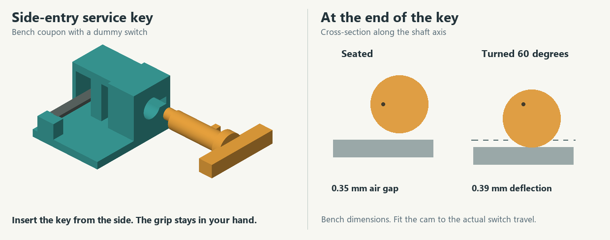

# Side-entry key for the UNO Q power button

The proposed backpack has a recessed side opening. Insert the printed key, turn its 20 mm thumb grip through 60°, turn back and withdraw it. The eccentric at the inner end converts that turn into a short press. Its stop keeps the cam short of dead centre. Keep the key at the dock during motion. The passive guide stays on the Duck and presents a fixed outer surface during falls and get-up.



The target is the white **JBTN1** beside the UNO Q USB-C connector. A short tap currently cycles the Duck's matrix readouts. A hold of at least five seconds reboots the Linux processor. The V1.1 carrier has a separate slide switch **SW1** for robot power. Its position matters for charging. [Arduino UNO Q user manual](https://docs.arduino.cc/tutorials/uno-q/user-manual/) · [XGO V5 assembly](https://wiki.xgorobot.com/kb/the-xgo-series-robot/duck-guide-06?model=duck) · [Charging circuit](CHARGING-WIRING.md)

The UNO Q STEP places the 3 mm cap about 5.84 mm from the USB-end edge and 3.93 mm from the adjacent long edge. It presses perpendicular to the PCB. Registering the V1.1 carrier via three mounting holes puts the button under solid carrier material. One P3 solder-pin centre projects about 1.34 mm from the cap centre. This is why the proposed key enters between the boards from the edge. The allowable thickness of its tip depends on actual solder-tail height and the seated gap. [UNO Q STEP](https://docs.arduino.cc/resources/models/ABX00162-step.zip) · [V1.1 carrier STEP](https://github.com/LuwuDynamics/xgoduck_hardware/blob/4496fad52041db1cad36ded6cc49d942e037b4af/PCBA/Step/ArduinoUnoQV1.1.step)

## First print

Print `duck-button-bench-guide.stl` and `duck-button-thumb-key.stl` as a detached practice pair. The guide includes a printed flexible strip that stands in for the switch. The assembly drawing shows the key partly withdrawn. Both STLs use millimetres and include their bed orientation. Check the slice under the dummy strip and around the shaft lug. Use removable local support as needed and clear the bearing and slot before testing. The coupon is for the bench only.

```sh
python accessories/v5-slide-on-backpack/button-key.py path/to/output
```

Align the key lug with the entry slot, slide the key to the shoulder and turn the grip until the guide stops it. Watch the strip deflect and return as you turn back. Try straight insertion without turning, and gentle attempts to turn while partially seated. The strip should remain free in both cases. If the key binds, inspect the slot and bearing for print sag before applying more force.

The coupon uses a 0.85 mm eccentric offset, a nominal 0.35 mm gap in neutral and 0.39 mm of displacement into the dummy target at full turn. These dimensions demonstrate the mechanism. They are independent of JBTN1's allowable stroke. The generator checks rigid clearance at 0.25 mm insertion increments and one-degree rotation increments. It also checks the turning stops, partial insertion, withdrawal while turned and engagement with the dummy target. Button force, material flex and print tolerance require a physical test.

## Integrating it with the V5

1. With the actual UNO Q, V1.1 carrier and harness seated and power disconnected, locate JBTN1 relative to the fixed enclosure. Measure its press direction, cap height, click travel and the space with USB and audio/video leads plugged in. Confirm the route reaches only the cap and guards the adjacent components.
2. Attach the guide to the fixed enclosure, align the backpack's side aperture with it and recess the entrance behind the existing impact surfaces. This keeps the cam datum independent of clearance in the slide-on cover. Orient the key entrance away from the chair guides, charging pads and release tongue. The cover must slide down from above with the key removed.
3. Set the cam and mechanical stop from the measured switch and its allowed travel. Provide free clearance with the key inserted in neutral across the print-tolerance range. The enclosure carries the stop load. Confirm short presses release, then try a deliberate hold with the stationary Duck supported and torque off.
4. With the key removed and power disconnected, load the rear, each side and the dock contact surfaces. Check witness material over the cap for contact with a deflected shell. Repeat during a supported roll and get-up sweep, including the skated configuration. Record the fixed guide's measured mass when registering the final control-policy layout.

The production enclosure and cover STLs currently contain the slide mount only. Locating a button passage in those parts depends on the assembled board and cable measurements above.
