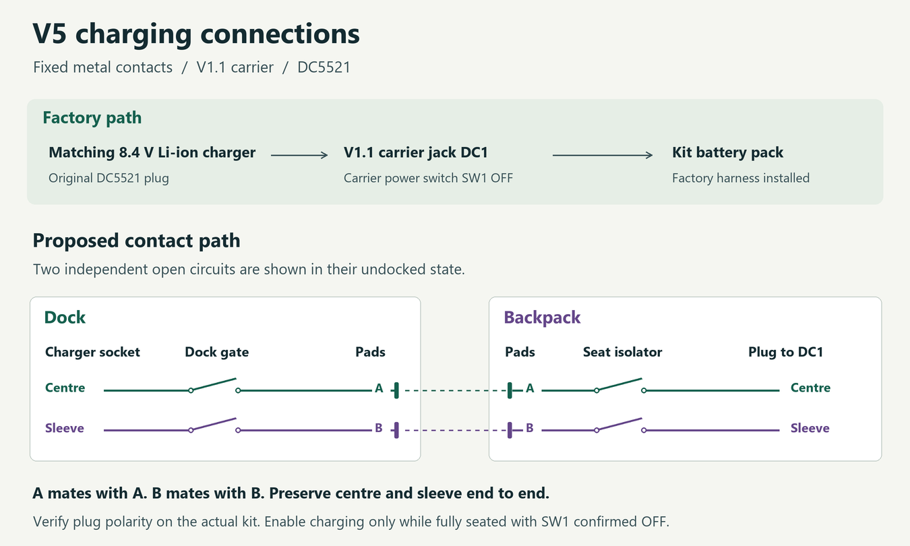

# Charging through the V5 backpack

**Use the charger matched to your battery and route its low-voltage output to the V1.1 carrier’s existing barrel jack, DC1.** The two fixed metal pads replace a plug-and-unplug action. The charger still controls the battery charge. Leave the pack and its factory connector in place. Luwu specifies an 8.4 V Li-ion charger with a 5.5 × 2.1 mm plug and requires the carrier power switch to be **OFF throughout charging**. Check the actual pack and charger labels before making the harness. [Luwu V5 specifications](https://wiki.xgorobot.com/kb/the-xgo-series-robot/duck-specifications) · [V1.1 power instructions](https://github.com/LuwuDynamics/xgoduck_hardware/blob/4496fad52041db1cad36ded6cc49d942e037b4af/PCBA/README.md)

## The contact harness

The lower drawing is a proposed circuit architecture. Component ratings, actual polarity, contact performance and the OFF-state interlock still need bench verification. The printed backpack provides two pockets on 56 mm centres. Its metal strips, leads and electrical isolation are additional parts.

| Connection | Centre conductor | Sleeve conductor |
| --- | --- | --- |
| Dock input | Centre terminal of a female DC5521 receptacle accepting the original charger plug | Sleeve terminal of the same receptacle |
| Through the dock | First pole of the normally open dock output to **pad A** | Second pole to **pad B** |
| Across the chair/backpack interface | Dock A mates only with backpack A | Dock B mates only with backpack B |
| Through the backpack | Backpack A through one pole of its normally open isolator to the **centre** of a male DC5521 pigtail | Backpack B through the other pole to the **sleeve** of the same plug |
| Into the Duck | Plug the pigtail into **DC1** on the V1.1 carrier | Both conductors terminate at the same plug |

Use a keyed, insulated two-pole disconnect on the **carrier side** of the backpack isolator for cover removal. Add strain relief at the pigtail and pad exits. Key the dock approach and recess the contacts so a sideways or reversed landing cannot swap A and B. Label each *mating pair* on the assembled dock and shell. Left and right reverse when viewing the two faces separately. Here A means barrel centre and B means sleeve. Verify the actual voltage sign from the charger label and a meter.

## Why both halves need to switch

In the released V1.1 schematic, DC1 pin 4 connects to `Power_IN`. That net meets `BAT_SAFE` at the common terminal of the carrier switch SW1. DC1 pins 2 and 3 connect to ground. The battery-side path can therefore feed the barrel jack with the carrier switched off. A passive pigtail permanently plugged into DC1 could put battery voltage on an undocked Duck’s exposed pads. The proposed backpack isolator opens both conductors whenever the Duck is away from the keyed seat. The dock output separately keeps the empty chair unpowered. [V1.1 schematic](https://github.com/LuwuDynamics/xgoduck_hardware/blob/4496fad52041db1cad36ded6cc49d942e037b4af/PCBA/ArduinoUnoQV1.1.SchDoc) · [V1.1 connector locations](https://github.com/LuwuDynamics/xgoduck_hardware/blob/4496fad52041db1cad36ded6cc49d942e037b4af/PCBA/SilkscreenLayout/ArduinoUnoQV1.1.pdf)

A candidate backpack isolator is a sealed, DC-rated, two-pole normally open switch behind a keyed seat feature. The Duck's weight can hold the flat pads together while that separate feature operates the switch near full seating. Arrange the interlock to open before either pad becomes accessible on withdrawal. Size the complete harness and switches for the actual charger current, DC interruption and fault exposure. Select overcurrent protection with the wire and connector ratings and battery fault current in hand. An ordinary series diode adds voltage drop to the charger’s sensing path and changes the voltage at the pack.

## Manual first, automatic later

1. **Verify the stock route.** Check the kit’s factory charging operation using its original plug at DC1, with SW1 OFF. Disconnect bench USB power and other external power feeds.
2. **Prove the harness unpowered.** With the charger and battery disconnected, check centre-to-centre, sleeve-to-sleeve and isolation between paths. Use dummy mates to actuate the interlocks. Verify both paths stay open when unseated and that neither cross-connects during an offset approach.
3. **Test the dock against a dummy load.** With a current-limited test source, exercise correct seating, partial contact, withdrawal and reversed approach. Verify output disconnects on loss of seating, record the loaded voltage drop per contact and check for heating at the intended charge current. Confirm backpack pads remain isolated with the Duck undocked and its battery connected before enabling a real charge. Use the original charger for the first supervised docked charge and compare its termination behaviour against the stock route.
4. **For automatic charge and wake**, the dock needs an independently powered controller and a way to put SW1 physically OFF and verify its position, or a bench-validated equivalent that preserves the carrier's charging path. Support the Duck, release torque and shut down Linux, verify the carrier is OFF, then enable the charger. Open the charger output before restoring robot power or allowing movement. A button press, Wi-Fi reboot and torque-off each leave the carrier switch state unresolved. If seating or OFF verification is lost, revert to charge disabled.

For the fixed-metal version, the extra circuitry handles isolation and sequencing. One matching Li-ion charger is sufficient. A wireless variant introduces a different power path and needs a receiver and a charger compatible with the actual pack and receiver output.
