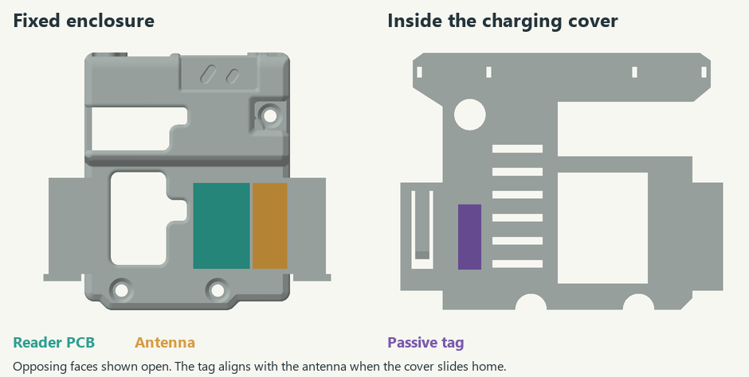

# Identifying a slide-on backpack

One powered reader stays on the Duck. A small passive 13.56 MHz ISO 14443A tag sits on the inward face of each interchangeable backpack. Swapping packs needs no NFC wiring or batteries on the removable side. The electronics below are a proposed fit. Identification has yet to run on the Duck.

| Where | Part | Reserved space |
| --- | --- | --- |
| Fixed V1.1 enclosure | ELECHOUSE PN5321 MINI reader PCB | 25 × 16.4 × 4.4 mm between locating shoulders |
| Fixed enclosure, facing backpack | Smaller of its two ferrite-backed antennas | 25 × 10 mm on an adhesive landing |
| Charging or articulated-tail cover, inward face | Passive tag with stable UID, e.g. NTAG213; choose by finished dimensions including backing | 18 × 7 × 0.85 mm recess for a tag up to 17 × 6 × 0.70 mm |

The reader supports 3.3 V and selectable I²C, SPI and UART. The small antenna has a 100 mm lead. Its cable, plugs, solder joints and service loop need a physical trial behind the seated cover. The UNO Q has Wi-Fi and Bluetooth and requires an external NFC reader. Arduino-format PN532 shields exist, but the compact module avoids adding another shield above the Duck carrier. [Reader and antenna](https://www.elechouse.com/product/pn532-mini/) · [Reader manual](https://www.elechouse.com/wp-content/uploads/2024/07/Elechouse-Pn5321-Mini-Product-Manual-V1.pdf) · [UNO Q specifications](https://docs.arduino.cc/resources/datasheets/ABX00162-datasheet.pdf) · [Arduino-format shield](https://www.adafruit.com/product/789)

## Connecting a prototype

One tag that fits the footprint is the IDColor TR27C67 NTAG213, specified at 15 × 6 × 0.7 mm and 0.2 g. Confirm the installed thickness with any adhesive. Relative to the original charging assembly, the optional fixed print adds 606 mm³ and the cover pocket removes 107 mm³. The net change is about **0.62 g of solid plastic** at 1.24 g/cm³, before the tag, PCB, antenna, splitter and cables. [Tag datasheet](https://www.idcolor.it/media/tech/it/TR27C67_scheda_tecnica.pdf)

The stock V5 uses the UNO Q's Qwiic connector for the head distance sensor. A passive Qwiic splitter would keep that sensor connected and provide a second 3.3 V I²C branch. Set the reader's solder jumpers for I²C and use an adapter wired by signal name (3V3, GND, SDA, SCL). The reader has no Qwiic plug. Confirm available supply current, bus timing, bus pull-ups, and support for the chosen driver on the UNO Q microcontroller before installing it. Bench-test both devices together while checking range sensor updates and missed control slots. [V5 wiring instructions](https://wiki.xgorobot.com/kb/the-xgo-series-robot/duck-guide-06?model=duck) · [UNO Q user manual](https://docs.arduino.cc/tutorials/uno-q/user-manual/)

## Fit and read test

1. Generate the two optional prototype STLs with `python pack-id.py output-directory` from this directory. The charging version uses 0.25 mm rail clearance per face. Print a rail coupon in the intended material first.
2. Dry-fit the PCB on insulating tape and put the antenna on the adjacent landing with its active face toward the tag. Recess the tag face below the cover surface. Secure the antenna and the cable on the Duck side. Check clearance and cooling with the actual cable and both packs in place.
3. In the seated CAD, tag and antenna have a nominal **1.80 mm face gap**. The tag and enclosure-mounted components clear the 76 mm release slide. The checks include the proposed charger harness envelopes. They exclude the NFC cable, actual radio tuning and adhesive tolerances.
4. With motors disabled, read each pack repeatedly through complete insertion, partial insertion and removal. Repeat beside the charging metalwork, with charging active, and with the other tagged pack nearby. The distance at which a tag first reads can exceed the gap at the latched position.
5. For future firmware, register each UID against a named loadout. Publish a pack change only after consistent reads, clear stale identity after removal and show an unknown state for unregistered tags. Pair the selected layout with the model fingerprint in Duck Lab. Latch engagement and electrical contact need independent checks. Weigh the PCB, cables, tag and new print before qualifying the locomotion model.
