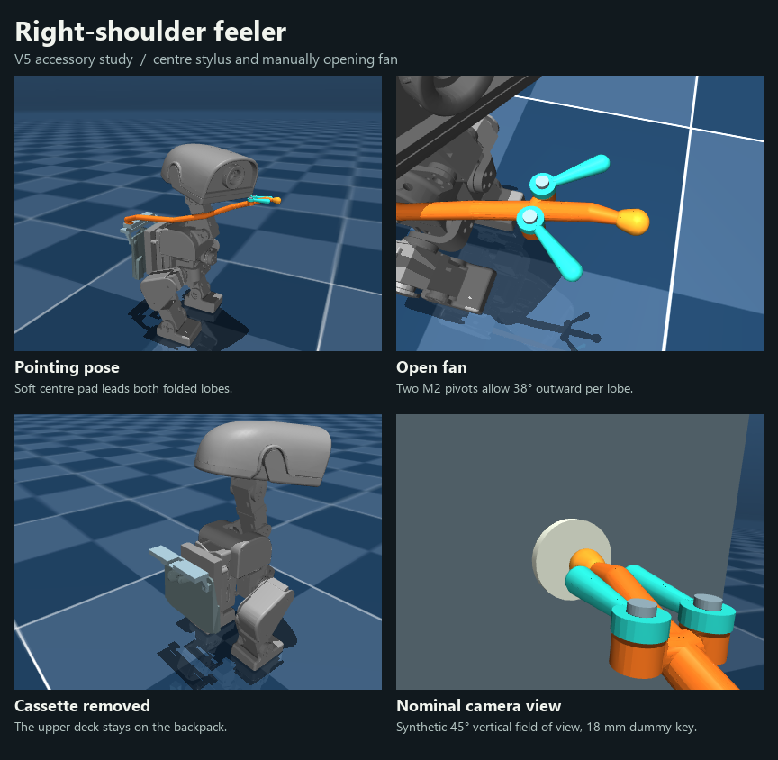

# Right-shoulder feeler

The [Grove Vision AI V2 camera cassette](grove-shoulder/README.md) uses the same deck and routes a removable cable back to the backpack.

This removable cassette carries a soft centre stylus and two rounded lobes that fan out like a duck foot. The folded pose leaves the centre pad leading for an upright pushbutton. Each side lobe pivots by hand around an M2 screw. The open illustration uses 38° on each side. Screw friction sets the pose. An autonomous scanner would need sensors, actuation and control.

**Use the shoulder tool for stationary tasks.** It passes a simulated planted-foot reach test, but neither fan pose meets the stock get-up gate. On a Duck equipped with the 167 mm tail and roll shoes, removing the shoulder cassette restores right-side recovery in the test below. **Centre the head before withdrawing the cassette.**

## Parts and assembly

| Printed component | Material and use |
|---|---|
| [Cassette and rigid boom](print/shoulder-feeler/shoulder-cartridge-stem.stl) | One connected print. The boom merges with 45.76 mm³ of the right upper surface of the cassette. |
| [Centre pad](print/shoulder-feeler/shoulder-soft-centre.stl) | TPU. Import with the rigid STL as two material bodies of one assembly and preserve their shared coordinates. The pad covers a tapered rigid core. Confirm the material bond and pull retention on a sample. |
| [Inboard lobe](print/shoulder-feeler/shoulder-soft-inboard.stl) and [outboard lobe](print/shoulder-feeler/shoulder-soft-outboard.stl) | TPU. The flat face of each pivot boss sits on the bed. Each lobe uses a 2.30 mm nominal through hole. |

The rigid and soft centre STLs use a shared origin. **Import them together before auto-arranging.** Print the lobes separately. The fused boom's print-frame envelope is approximately 94 × 224 × 83 mm. Plan supports under the cantilever and check the first-layer preview. The STLs passed a closed-edge check after export. The study does not include a physical print.

1. Place each lobe on its pivot boss with the two fingers pointing towards the centre pad. Fit an M2 screw and retaining nut per side. Choose length against the printed stack and actual head/nut dimensions. Set friction so the lobes can be moved by hand and retain their pose. Check free movement and hardware clearance.
2. With the Duck supported and head centred, slide the cassette into the deck from the rear and engage the deck pin. The boom footprint uses seated enclosure coordinate **X −26, Y +50.20, Z −15 mm**. The centre pad has a 3.6 mm radius.
3. Return the head to neutral before pulling the pin and sliding the cassette 30 mm rearwards. The sampled removal path had **5.11 mm** minimum nominal clearance at neutral. The same move with the head aimed at the button produced **3.14 mm of overlap**. Neutral here means neck pitch +20°, head pitch +20°, yaw and roll 0° in the walking model.

Using the CAD solid volumes, the fused cassette/boom is estimated at 16.61 g, the centre pad at 0.24 g and the two side lobes at 0.39 g each. The dynamics model also allows 0.30 g for each M2 screw/nut pair and includes the actual upper deck and slide pin. The complete loaded deck/cassette/tool adds **25.94 g** above the existing backpack, or **7.58 g** for the empty deck. Measure the printed mass, hardware and press force for a physical trial.

## Camera and press

The nominal camera is the V5 walking model's head lens site, looking forward along the bill. The synthetic lens uses a 640 × 480 frame. With neck pitch +20°, head pitch +30°, yaw −25° and roll 0°, the pad centre projects to **(332, 265)** at 45° vertical field of view. Approximately 912 pixels of the soft pad remain visible in a four-pixel-spaced ray sample. The stem masks the central sight line. The pad also remains visible at the tested 35° and 55° vertical fields. The panel shown is a synthetic 18 mm key.

The nominal distance from the tool envelope to the stock head/neck is 9.48 mm at aim, with an 8.68 mm minimum along the 31-pose path from neutral. The pad projects 43.27 mm ahead of the stock Duck against an upright panel. A kinematic leg adjustment advanced the trunk-mounted tip 2.00 mm while preserving both foot poses. The largest leg change was 1.94°, sole translation error was below 0.001 mm and the projected centre of mass stayed at least 18.73 mm inside the modeled two-foot support polygon.

The head aims the camera. **The torso provides the press stroke.** Key actuation and allowable force remain unmeasured. A clamped circular-beam estimate at an assumed 2 GPa rigid-filament elastic modulus gives about **1.69 mm of boom deflection per newton** along the press direction. A 0.30 N contact load would consume about 0.51 mm of stroke in the boom alone. TPU, printed layer direction, cassette play and leg compliance will affect that estimate. No measured lens calibration, electrically detected button press or autonomous key-seeking controller is included.

## Get-up screen

Each direction starts at 90° on level ground. The unmodified walking and get-up policies run for 20 simulated seconds. The stock fall gate requires recovery within 8 s, an upright finish and resumed walking. Each direction here is one matched trajectory.

| Configuration | Flat walk, 0.20 m/s command | Passed 90° get-ups |
|---|---:|---|
| Stock Duck | 2.59 m | 4/4 |
| Fixed backpack mount and empty upper deck | 2.44 m | 2/4, left and front |
| Backpack, upper deck and folded shoulder tool | 2.44 m | 0/4 |
| Backpack, upper deck and open shoulder tool | 2.44 m | 0/4 |

In the additional 167 mm compact roll-shoe tail trial, the controller stood from a right-side fall in 3.32 s with the empty deck, transitioned to the moderate forward lean, and walked another 2.346 m. The shoulder boom prevented that recovery in both fan poses. Removing the cassette leaves the backpack mount and deck attached. Full stock-side recovery and rollout require their own assessment after any carrier change.

The physics uses CAD-derived mass and inertia, convex-sliced deck and cassette contacts and capsule envelopes for the thin stem, lobes and hardware. Stock head, neck, trunk, legs and floor contacts are enabled. The clearance tests sample ideal dimensions and do not bound all possible motions. Keep this shoulder option separate from configurations intended to fall and get up without operator intervention.

[Simulation outcomes](shoulder-evaluation.json) · [Print dimensions and masses](shoulder-print.json) · [CAD generator](shoulder-pointer.py) · [Test and camera geometry](check-shoulder-pointer.py) · [Figure generator](render-shoulder-pointer.py)
