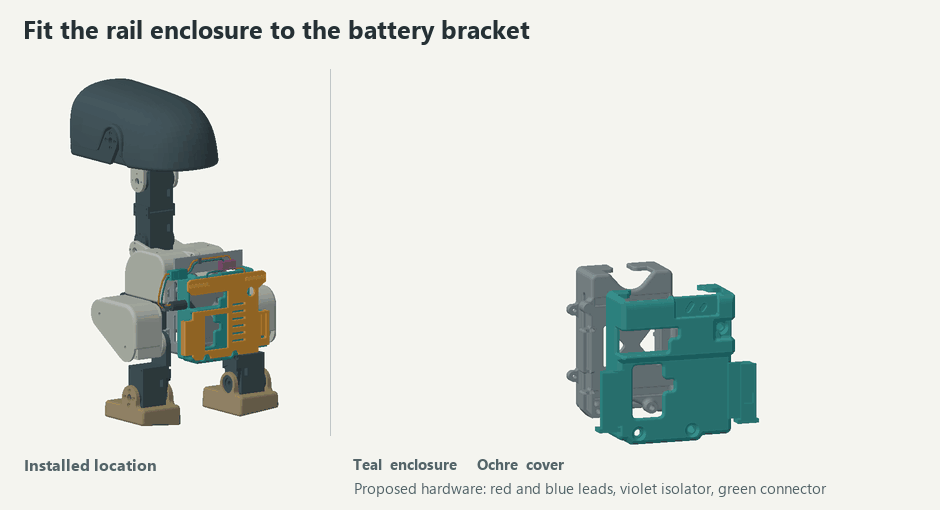
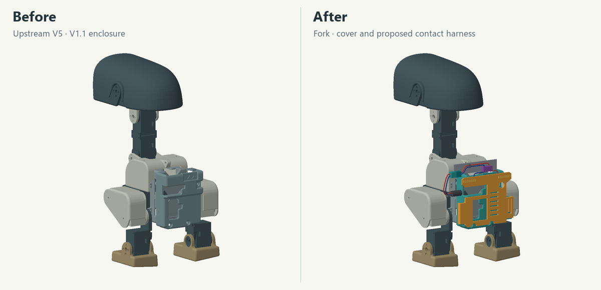
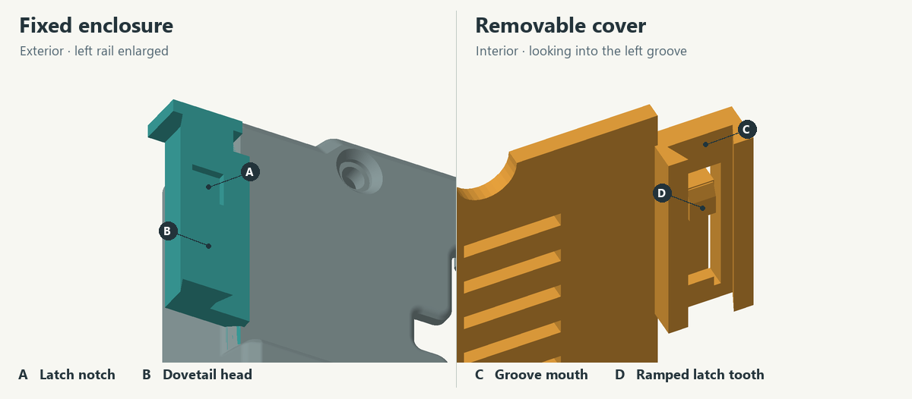
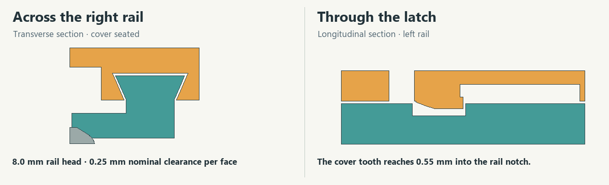
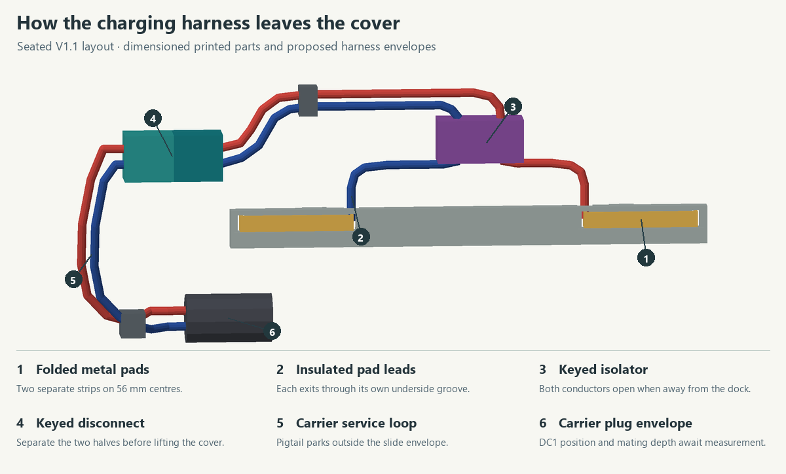

# V5 charging backpack compared with upstream

This fork adds a removable fixed-contact backpack to Luwu’s **V5 audio/video Duck with the V1.1 carrier**. One generated print replaces the stock electronics enclosure. A second print slides onto it and latches. The battery bracket and its original mounting hardware stay on the Duck.

**Install from above with the Duck upright.** Lower the cover along the two rails until its socket ends bear on the printed lower shoulders. Gravity seats the cover in ordinary standing use. A releasable tooth retains it when the Duck rolls onto its back or turns upside down. For removal, lift the latch tongue outward and slide the cover toward the head.

## Assembly in motion

The teal enclosure and ochre cover come from the exported **0.25 mm clearance STLs**. The grey bracket stays fixed. The two leads, contact strips, isolator, tray, connector and barrel pigtail are proposed hardware envelopes. The operator parks the carrier half of the keyed connector outboard, lowers the cover, seats the latch and then mates the connector by hand. Reverse that order for removal. The pigtail stays with the carrier. The PCBs and neck cables are omitted. The barrel plug envelope marks the proposed terminal end. Its location, axis and insertion depth still need registration to the actual carrier. In the physical stack, the UNO Q attaches to the battery bracket with its matrix and headers facing the expansion carrier. The blue carrier sits closer to the removable cover. Its cutout provides a sightline to the matrix. Button and cable access need a check on the assembled kit. [Luwu assembly photos, step 23](https://wiki.xgorobot.com/kb/the-xgo-series-robot/duck-guide-06?model=duck) · [Carrier STEP](https://github.com/LuwuDynamics/xgoduck_hardware/blob/4496fad52041db1cad36ded6cc49d942e037b4af/PCBA/Step/ArduinoUnoQV1.1.step)

## The Duck before and after

Both views use the same camera, pose and scale. The V5 body shells, battery bracket and enclosure placement come from Luwu’s 3MF assembly. The head, neck and legs use Luwu’s walking-model meshes aligned at the hip pivots for context. The stock enclosure STL was registered to the corresponding 3MF vertices to within 0.001 mm. In that assembly, local enclosure **+Y points toward the head**. The generated cover installs toward **−Y** and withdraws toward **+Y**. [Upstream V5 assembly at the comparison revision](https://github.com/LuwuDynamics/xgoduck_hardware/blob/4496fad52041db1cad36ded6cc49d942e037b4af/3DManufacturingFormat/xgoduckV5.3mf) · [Walking-model geometry](https://github.com/LuwuDynamics/xgoduck_rl/tree/fa621fc77ad9a05d69da13270e86118bdd3603fe/src/mjlab_microduck/robot/xgoduck)

| Part | Upstream V5 | Fork prototype |
|---|---|---|
| Electronics enclosure | V1.1 enclosure mounts to the battery bracket | Same source enclosure and mounting interface, with two outboard 28 mm dovetail rails, fixed lower shoulders and a latch notch in the left rail |
| Removable cover | No mating slide-on cover in the stock print set | Two through-grooves slide over the rails. The lower socket faces meet fixed stops. A printed tongue retains the cover without a separate pack fastener. |
| Charging interface | No pair of printed contact pockets on this enclosure | Two pockets on 56 mm centres accept folded metal strips. Each pole has its own lead groove. The contacts sit at the headward edge in this revision. |
| Installed envelope | Stock rear plane | Cover face extends 3.2 mm beyond that plane. The contact ears span 77.6 mm. Overall socket width is 84.0 mm. |

## How the slide and latch engage

**A and B** are on the fixed enclosure. **C and D** are on the moving cover. The groove mouth **C** receives the wide rail head **B**. The undercut resists separation away from the board. At the end of travel, the tooth **D** seats in notch **A** and resists sliding back out.

The left section cuts across the unlatched rail. The 8.0 mm head sits inside a groove offset by 0.25 mm per face. The right section cuts lengthwise through the other rail and its 1.35 mm thick release flexure. The tooth projects 0.55 mm into the notch. The bright gaps show the modeled clearances.

Moving the sockets outside the stock enclosure clears its raised headward rim. The CAD check swept the released cover continuously through 76 mm at all three clearances. At 0.25 mm, the seated pair and released travel have zero modeled interference. Forcing the released cover 0.5 mm farther downward overlaps the fixed stops by 10.48 mm³. Pulling the engaged cover 1.5 mm upward overlaps the latch by 2.31 mm³. These interference checks establish direction and engagement. Retention force depends on material and print quality.

At nominal clearance the enclosure gains 3.65 cm³ and the cover adds 8.80 cm³. This corresponds to about 15.44 g of solid PLA at an assumed density of 1.24 g/cm³. Weigh the actual printed pair, conductors, terminals and wiring before qualifying a walking or get-up policy for this loadout.

## Proposed contact harness and mass

Both pole A (red) and pole B (blue) run from a folded strip through the groove at its inner end. Each reaches its own pole of the normally open isolator, then the removable two-pole connector. The fixed side loops back to the barrel pigtail. The grey part under the upper leads in the animation allows space and mass for an insulated tray. Its anchors and the mechanical key that operates the switch still need design around selected parts. The cutaway removes the tray and most of the printed lip so both paths are visible. [Route coordinates and mass budget](contact-harness.json) · [Charging connections and OFF-state interlocks](CHARGING-WIRING.md)

| Addition relative to the stock Duck | Low | Nominal | High |
|---|---:|---:|---:|
| Printed enclosure additions and cover | 11.20 g | 15.44 g | 16.56 g |
| Harness, including both contacts, insulated wires, keyed isolator, connector halves, plug, tray and clips | 7.98 g | 14.74 g | 27.91 g |
| Combined incremental mass | 19.19 g | 30.18 g | 44.47 g |

The nominal harness uses 236 mm of insulated conductor summed over the six lead sections. The preview uses 24 AWG dimensions with 11 copper strands at 0.160 mm and a 1.4 mm jacket OD. The combined mass centre is (10.77, 13.77, 2.15) mm in the installed enclosure STL frame. Weights and component centres are design estimates. Choose the wire and connector ratings against the actual charger's current before making the harness. Measure its assembled weight and centre of mass for training. [Wire dimensions](https://www.pololu.com/category/139/stranded-wire)

CAD checks found zero overlap between the routed harness and the seated printed parts. The carrier pigtail cleared the print at nine sampled positions while moving from connected to parked. With the carrier half parked, the cover, insulated leads and backpack components cleared the fixed print and pigtail through a continuous 76 mm sweep. This result covers the proposed paths and rigid envelopes. Cable slack, bend life, dock clearance, strain relief and actual port location still need the real assembly. [Run the routing checks](harness-geometry.py)

## What to verify before the full print

The local roll-envelope check places a flat plane against the seated enclosure, cover and proposed charging harness. During right-side contact, the pigtail reaches **21.20 mm beyond the cover**. At 45° between the back and right side, the lead is still **10.66 mm proud**. On the back alone the pad faces are 0.05 mm proud. Extending the cover toward the head leaves the right-side exposure unchanged. Move the pigtail inside the fixed enclosure's outline, strain-relieve it there and recheck dock contact before choosing the size of any rounded protective runners. Which part of the whole Duck hits first, the transmitted load and latch strength need a full-assembly roll and physical retention test. [Reproduce the local contact-plane check](check-roll-envelope.py)

1. **Choose clearance with the coupons.** Print the short rail and three test sockets in the intended material and orientation. The choices are 0.15, 0.25 and 0.35 mm per face. [Coupon generator](rail-fit.py)
2. **Check access on the actual V1.1 build.** Allow room on the head side for insertion and removal. The 76 mm released-cover sweep cleared the fixed enclosure. Its bounding box also cleared the battery bracket, body shells and hip support from the V5 assembly and the head, neck and leg meshes in the illustrated upright pose. Check the full neck range, matrix sightline, button access, plugged headers and USB cable bends on the assembled Duck.
3. **Dry-fit the charging contacts.** Each pocket is 20.5 × 2.9 × 0.45 mm. The 56 mm pitch matches the chair experiment. Verify that both pads land together on the chair in the actual installed orientation, and that the keyed connector can be separated and parked before moving the cover. Pull-off force, latch fatigue, electrical charging and get-up with the finished pack remain unmeasured.

The comparison baseline is upstream commit `4496fad52041db1cad36ded6cc49d942e037b4af`. The generator verifies the stock STL checksum and writes two separate derivative files. Use its clearance argument to reproduce the illustrated pair. [Stock V1.1 enclosure](../../structure/V5_AUDIO_VIDEO_/V5_AUDIO_VIDEO_ENCLOSURE_FOR_V1P1.stl) · [Backpack generator](charging-pack.py) · [Build commands](README.md)
