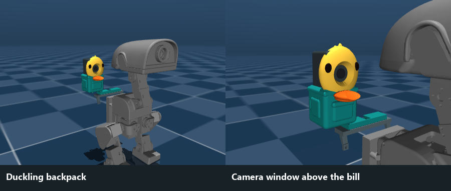

# Duckling camera backpack

The Grove Vision AI V2 and its camera stay in their own case. Slide the case in from behind the little backpack, with the lens facing forward. The lower pocket takes its weight. The yellow cheeks and orange bill frame the camera, and a notch at the bottom leads the cable back to the robot. The complete cassette rides on the existing shoulder deck.

## Check the housing before printing

The two large shell outlines in Seeed's published kit STEP have vertex spans of about **30.8 × 68.5 mm**. The STEP shows the parts laid out separately. This prototype assumes **28 mm assembled depth** and a centred lens **48 mm above the base**. The preview uses a rounded box for the enclosed kit. Measure your case, lens centre, lens projection and cable exit. [Seeed kit case STEP](https://files.seeedstudio.com/wiki/grove-vision-ai-v2/grove_vision_ai_v2_kit_case.stp)

The pocket allows 0.45 mm clearance per side. It has two slots for a soft retaining band and a 14 mm wide cable notch. The band and cable are separate from the print. Slide the case in with the cassette off the robot, route the band through the slots across the open back, and reconnect the lead after fitting the cassette. Leave slack at the backpack end. Check the plug and strain relief against your particular housing.

## Print options

- **One filament.** Use `duckling-pocket.stl`.
- **Four tools.** Select all four STLs in `duckling-colours/` and import them as parts of one object, keeping their positions. Assign teal to the pack, yellow to the head, orange to the bill and dark filament to the eyes. Preview supports around the bill and rail before printing.

The CAD check verifies a continuous rear insertion path for the rectangular case envelope and keeps a 62° cone clear ahead of the nominal lens plane. The single-piece and colour exports passed closed-edge checks. Solid printed volume corresponds to **35.47 g at 1.24 g/cm³**, excluding the housed Grove, cable, band, deck and pin. Loaded walking and recovery, the physical lens view and physical retention still need testing.

Run `python duckling.py --width 30.8 --height 68.5 --depth 28 --lens-height 48` to regenerate the kit in millimetres. The design assumes a horizontally centred lens. The generator writes the STL and colour bodies in this directory. `python render.py --duckling` renders the default reference dimensions on the V5. The [bare-board variant and electrical notes](https://github.com/matthewhand/xgoduck_hardware/blob/v5-slide-on-backpack/accessories/v5-slide-on-backpack/grove-shoulder/README.md) cover the earlier exposed-camera cassette and the Grove interface.
