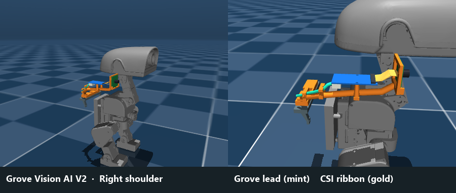

# Grove Vision AI V2 shoulder cassette

This fit prototype slides into the [shoulder deck](../stack/stack.py) in place of the folding feeler. A forward-facing OV5647-62 camera sits at the end of a short boom. Its CSI ribbon runs to the Vision AI board on the same cassette. Two open-sided guides take the four-wire Grove lead back to the backpack. Leave a service loop there and unplug it before withdrawing the cassette.

## Print and dry-fit

The [single-piece carrier STL](grove-shoulder-cassette.stl) includes the rail key, boom, two hollow standoffs, cable guides and camera seat. Use the existing deck and slide pin. The nominal solid-print estimate is 13.89 g at 1.24 g/cm³. Weigh the complete cassette with the PCB, camera, screws, cable and strain relief before running recovery trials.

1. Print the carrier with the rail side oriented as exported. Preview supports under the cantilever and check the connector openings in your slicer.
2. Seat the bare Vision AI V2 board on the posts with the Grove connector toward the backpack. The PCB is approximately 40 × 20 mm. The hole pitch of 16.545 mm comes from the two cutouts in Seeed's layout. Use two M2 through-screws with insulating washers where needed and nuts below. Select screw length against the actual printed posts. The camera is the 25 × 23 × 9 mm OV5647-62 variant. Place it lens-forward on the ledge and feed a soft band through the two slots above the lens, checking component clearance. [Board layout](https://files.seeedstudio.com/wiki/grove-vision-ai-v2/Grove_Vision_AI_Module_V2_Layout.zip) · [Camera variants](https://www.seeedstudio.com/Grove-Vision-AI-V2-Kit-p-5852.html)
3. Connect the CSI ribbon with the power off and follow Seeed’s contact orientation. Seat the Grove cable sideways in the two guides. Add a releasable tie at the backpack for strain relief. Check the real cable bundle, plug, ribbon bend and the head’s movement by hand with motors off. [Seeed camera hookup](https://wiki.seeedstudio.com/grove_vision_ai_v2/)

`python carrier.py` generates and verifies a single connected, closed STL and checks the carrier against the nominal PCB, camera, plugs and cable envelopes. `python render.py` renders the fitted cassette using the adjacent runtime checkout. The board model omits most components. Actual print fit, plug access, the head sweep, vision and recovery with the loaded cassette still need testing.

## Electrical interface

The Duck already uses its 3.3 V Qwiic bus for the head ToF sensor. The Seeed production schematic labels the Grove VCC and signal nets as 5 V, although its bootloader recovery guide describes a 3.3 V hookup. For an installed Grove connection, verify the specific module revision, its pull-ups and current draw. The proposed harness uses a regulated supply matched to the module and a bidirectional I²C level shifter between the existing Qwiic branch and the Grove connector. Keep the ToF branch in service and check its readings alongside inference results. The two renders show the route to the backpack. An adapter and power supply are separate components. [Seeed schematic](https://files.seeedstudio.com/wiki/grove-vision-ai-v2/Grove_Vision_AI_Module_V2_Circuit_Diagram.pdf) · [Seeed recovery hookup](https://wiki.seeedstudio.com/grove_vision_ai_v2/#hardware-connection) · [UNO Q manual](https://docs.arduino.cc/tutorials/uno-q/user-manual/) · [V5 wiring](https://wiki.xgorobot.com/kb/the-xgo-series-robot/duck-guide-06?model=duck)

## Proposed community bounty

**Duck Spotter.** Fit the removable cassette and report dock-marker detections from the Grove to Duck Lab while the head range sensor keeps updating. Publish the CAD changes, measured all-up mass, wiring, model and a timestamped run log. Suggested judging set: 20 marked approaches and 20 look-alikes in a shuffled order, at least 18 marked detections and zero false dock declarations. Include inference latency and missed control slots with the module enabled and disabled. A separate simulation round can compare the four get-ups with the weighed cassette.

Seeed invites competition organizers to request product or other sponsorship at **fusion@seeed.io**. Before announcing a prize, confirm the winner can redeem the specific coupon, its product eligibility, expiry and minimum spend. [Seeed competition sponsorship](https://www.seeedstudio.com/fusion-pcb-pcba-sponsorship.html)
