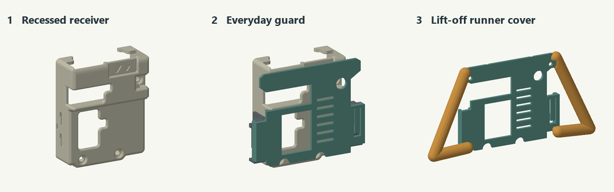

# Removable V1.1 rail cartridges

This replacement enclosure lets the Duck shed **both rails** before rolling. Shallow T-slots and detent pockets are recessed into the outer sidewalls of the V1.1 enclosure. Each cartridge carries the existing dovetail and lower stop, two T-headed feet and a printed release tongue. The left cartridge also carries the cover-latch notch. The previous fixed-rail enclosure and its existing qualification results remain a separate build option.

## Assembly

1. Print the [flush receiver](print/flush-receiver-v1p1.stl), [left cartridge](print/left-rail-cartridge.stl) and [right cartridge](print/right-rail-cartridge.stl) in millimetres. Install the receiver in place of the upstream V1.1 enclosure.
2. Pull a cartridge tongue slightly outward. With the cartridge displaced 5.8 mm toward the head, place both T-heads into the wider openings on the corresponding sidewall. Slide the cartridge toward the feet until the tongue seats in its pocket. Repeat on the other side. The left rail's cover notch faces the cover release tooth.
3. Lower the top-entry backpack until its two stops and latch engage. Test by hand with electronics unpowered.
4. For a pack-off roll, remove the cover, pull each cartridge tongue outward, slide the cartridge 5.8 mm toward the head and withdraw it sideways. All cartridge heads, ears and stops leave the Duck. The intake pockets stay recessed in the host enclosure.

## Fit and qualification

The CAD sweep checked the cover's 76 mm service stroke, both cartridge motions and the seated hardware. Checks found zero three-dimensional intersection along those modeled trajectories. Measured CAD engagement includes the lower cover stops, cover latch, two cartridge heads and the side detent. The undercut is shallow and printed tolerances, release force, fatigue, shock retention, actual fingertip access and PCB/wiring clearance still need a bench fit. The sliding test represents the latch in its released position and supplies no flex-force estimate. [Generator](rail-cartridges.py) · [Fit results](receiver-profile.json)

**Installed recovery.** The 167 mm curved tail with compact paired roll shoes used the shipped walking and get-up policies. After a 90° right-side start, both the fixed-rail and cartridge models stood in 3.30 s. They then travelled 2.338 m and 2.316 m respectively along their heading at recovery, with a 12° reference and 0.45 m/s command. The cartridge model weighed 887.32 g including the robot and achieved 8.40° mean forward trunk pitch over the final five seconds. The test exchanges the rail mass, centres, inertia and collision hulls and subtracts the receiver's pocket material. Other attachments and initial orientations need separate checks. [Installed comparison](installed-right-recovery.json) · [Reproduce the test](check-installed.py)

**Pack-off roll.** The shipped roulade policy completed a full roll and returned upright for all four tested settle times with the cover and cartridges removed (361.0–361.4°). The original fixed-rail version with its backpack removed completed 0/4 (243.9–251.5°). The stock control completed 4/4. This compares those specific simulated loadouts. Stand-mounted electronics or other persistent modifications would change the roll model. [Pack-off roulade trials](../../v5-raptor-tail/roll-after-removal.json)

Removing both rails leaves the stock outer convex envelope. Every stock hull vertex remained in the revised part to numerical precision. The side pockets remove 294.92 mm³, or about 0.366 g of solid PLA at 1.24 g/cm³. The pack-off physics profile subtracts that mass and its body-frame inertia from the stock trunk. A rigid collision mesh using a convex hull cannot resolve local contact inside the small pocket openings. The cartridge pair increases installed mass by an estimated 5.70 g relative to the stock unmodified enclosure. The prior integrated pair added 4.52 g. NFC reader electronics and any cover or backpack are separate additions when qualifying either case. [Pack-off physics](receiver_physics.py)

Generate the STLs from the hardware repository with NumPy, SciPy and manifold3d available.

```sh
python accessories/v5-slide-on-backpack/removable-rails/rail-cartridges.py
```

## Everyday protective cover

The [plain guard](print/plain-protective-cover.stl) uses the same top-entry latch and vents. Its outer face omits the tail yoke, charging contacts, runners and stacking deck. Fit it on the two removable rails for everyday board protection. The [runner cover](../../v5-raptor-tail/roll-shoe-cover/README.md) replaces the plain guard when the tail is needed.



With the stock head, the receiver alone completed four of four simulated rolls. With the plain guard and both rails, three of four completed the roll and resumed walking. In the missed trial the robot turned 340.7° and fell during walk-off. These four settling times are a deterministic screen. [Recorded rolls](plain-guard-roll.json)

For the concealed-head build, the [rounded everyday guard](../rounded-guard/README.md) retained the covered area and passed all four nominal get-ups and roll launches.
