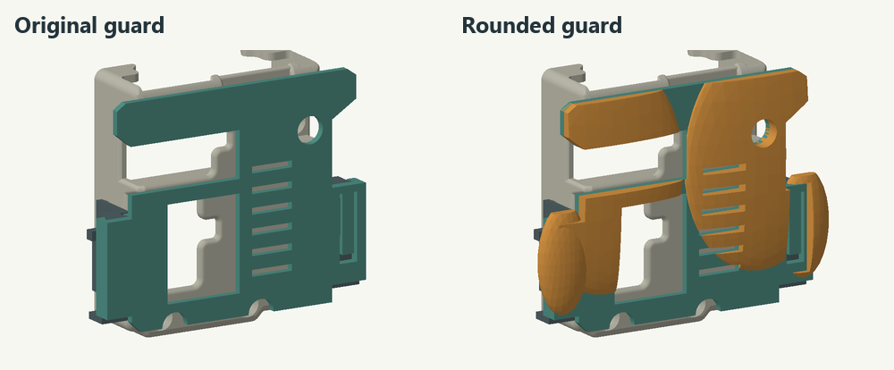

# Rounded everyday guard for the V5 V1.1 receiver



Use this [replacement protective cover](rounded-protective-cover.stl) with the existing V1.1 slide rails. Two shallow shoulders and rounded side pads shift where the cover meets the floor during get-up. The cover is 94 mm wide, up from 84 mm; the rear surface extends another 4 mm. It adds an estimated 10.19 g at 1.24 g/cm³.

The complete original guard material remains under the new surfaces. CAD checked all six vent slots, the board openings, service cutouts and access to the flexible release tongue. The released cover cleared a continuous 76 mm slide on both rail variants. The lower stops and engaged latch still interfere with withdrawal in their respective locked directions. Physical board cooling, impact protection, release effort and strength require a printed fit test.

The STL is in millimetres with the rail side toward the bed. Check the rail grooves, latch relief and curved overhangs in the slicer. Try an unpowered slide and latch test first, then check actual plug and finger access on the assembled board.

## Matched qualification

Both builds use the concealed head mounts with their inserts installed, the recessed rear receiver, two removable rail cartridges, no decorative accessories, the same stock ONNX policies and an identical level floor. Each get-up started at 90°. The trial lasted 20 seconds and required a return to walking and sustained forward progress.

| Start | Original guard | Rounded guard | Travel after recovery, rounded |
|---|---:|---:|---:|
| Back | Stayed down | 3.18 s | 2.06 m |
| Right | Stayed down | 3.42 s | 2.04 m |
| Front | 3.00 s | 3.10 s | 2.08 m |
| Left | 2.56 s | 2.56 s | 2.14 m |

Both completed all four original forward-roll trials, launched after 0.20, 0.50, 1.00 and 2.00 seconds of standing. The rounded cover turned 354.2–358.1° and returned to walking after each. Walking from an upright start covered 2.46 m in 20 seconds versus 2.51 m with the original guard.

At additional 85°, 88°, 92° and 95° release angles in each direction, the rounded cover passed 15/16; it missed at 95° on its right. Across seven additional roll launch times it passed six. At a 0.34 s launch it turned 317.3° and entered get-up. These are deterministic simulations using segmented convex contact surfaces, estimated print density and a rigid 3D model. They measure neither real-world success rate nor hardware control-loop timing.

## Playback and reproduction

Duck Lab loops the matched back and right recoveries by default. The playback selector also covers front and left starts and all four standard roll launches. The robot poses come from the policy runs. The displayed clock identifies the jump to the final state of each 20-second get-up trial.

[Fit](fit.json) · [Get-ups, rolls and walking](trials.json) · [Release angles](release-angles.json) · [Additional roll times](launch-times.json)

Run the CAD generator with NumPy, SciPy and manifold3d. Run the policy checks in the runtime qualification environment. The scripts expect the runtime and hardware repositories side by side.

```sh
python rounded.py 4 12 25 5 -10 -3
python check-guard.py
python check-guard.py --angles
python check-guard.py --timing
python replay.py
```
