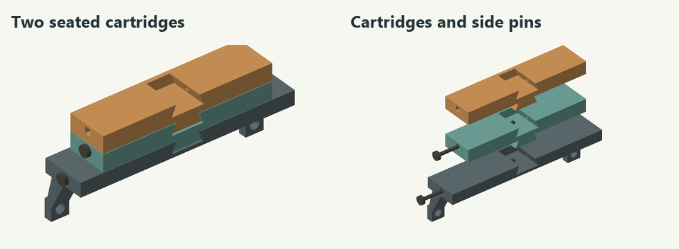

# Stackable backpack deck

The [deck](print/upper-deck.stl) shares the two original M3 yoke axes. Each foot adds 3 mm to the screw stack. Match the previous thread engagement and check for bottoming. For a dry fit, an original 8 mm screw would become an 11 mm screw of the same type.

Slide one [cartridge](print/stack-cartridge.stl) forward from the rear until it stops. Insert the [long pin](print/side-pin.stl) laterally from the right edge of the deck. A second cartridge can slide into the identical top track. Use the [shorter cartridge pin](print/cartridge-pin.stl) at that interface. Each flange remains outside its housing. The front stop and transverse pin block fore-aft motion in CAD. The printed pin relies on fit for lateral retention. Check retention with a coupon and on the bench before moving the robot.

One level adds 6.2 mm height. At 1.24 g/cm³ the modeled deck is 7.58 g, each empty module 6.40 g, and each pin about 0.12–0.14 g. The insertion sweep and two seated cartridges cleared in CAD. Each loaded arrangement changes clearance and inertia. The [shoulder-feeler trials](../SHOULDER-FEELER.md) demonstrate how an accessory can walk and still prevent recovery.

## Empty-stack policy trials

The 167 mm compact roll-shoe tail recovered from a 90° right-side fall with zero, one and two empty cartridges. Walking distance decreased with each additional level. All three configurations finished the walking test upright without falling, but each missed the 1.946 m gait threshold (75% of the bare Duck's 2.595 m).

| Empty cartridges on the deck | Total modeled robot mass | Walk in 20 s | Right-side recovery | Forward travel after recovery |
|---:|---:|---:|---:|---:|
| 0 | 889.08 g | 1.674 m | 3.32 s | 1.413 m |
| 1 | 895.62 g | 1.561 m | 3.28 s | 1.308 m |
| 2 | 902.14 g | 1.406 m | 3.34 s | 1.202 m |

Each row covers one level-ground walk and one right-side fall with the stock ONNX policies at a 0.20 m/s walking command. The model includes each level's actual slide pin, mass, inertia and ground-contact geometry. Loaded modules, other fall directions and physical parts still need their own tests. [Recorded outcomes](empty-policy-trials.json) · [Trial runner](check-empty.py)

[STL generator](stack.py) · [CAD fit results](stack-fit.json)
